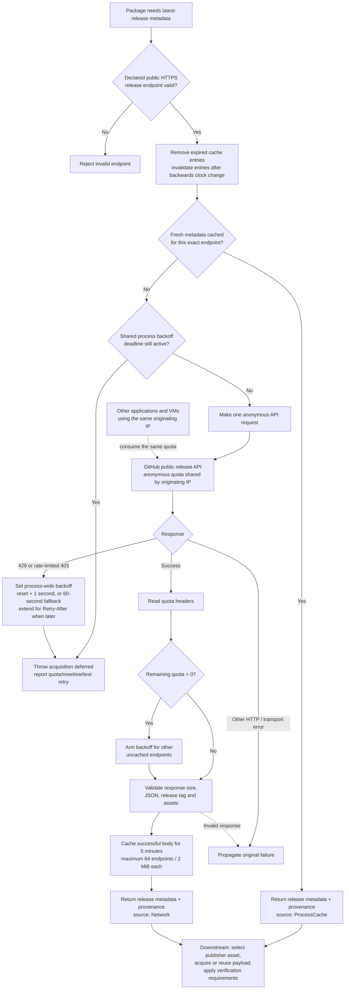

# GitHub latest-release discovery

`GitHubReleaseApi` package operations share release discovery in
`modules/RIDE-Packages.psm1`. The declared publisher endpoint and repository
remain authoritative; selecting another package does not create a separate quota.
Artifact versions, publisher repository checks and available digest/checksum
verification still apply to every acquisition, including cached payloads.

## Anonymous cache and backoff flow

Release metadata caching and rate-limit handling happen before downstream
publisher-asset acquisition. The cache and backoff are shared across release
endpoints within one package-module instance, not across processes or VMs.



Fresh cached metadata remains usable during backoff. An uncached lookup fails
immediately while the deadline is active: no sleeping, automatic retry, extra
quota request or expired-data fallback. A later caller can retry after the
deadline. The versioned installer payload cache is separate from this metadata
cache, and host preflight cannot reserve GitHub quota for a later guest request.
The implementation is in
[`Get-RideGitHubReleaseMetadata`](../modules/RIDE-Packages.psm1).

## Freshness and provenance

Successful release bodies are reused for **five minutes**, keyed by the exact
public release endpoint and authentication context, within the current package module instance and
PowerShell process. At expiry, resolution queries the publisher again; it never
falls back to expired data after a network or quota failure. Reloading the module,
starting another PowerShell process or restoring a VM clears this memory cache.
No release metadata is written to a persistent discovery cache or forwarded
from the host into a guest.

The cache retains at most **64 endpoints**, with at most **two MiB** per response.
Expired entries are removed before lookup and the oldest entry is evicted when
full. Cached input is serialized so consumers cannot alter subsequent selections.
A backwards clock change invalidates affected entries rather than extending
their lifetime. Latest means the publisher metadata fetched within this explicit
freshness window; a release published during that window is selected after expiry.

Resolved and saved artifact objects, observation-library entries and artifact
`.ride.json` sidecars include optional `ReleaseMetadata`:

| Field | Meaning |
| --- | --- |
| `ApiUri` | Declared public GitHub release API endpoint |
| `AcquisitionKind` | `Network` or `ProcessCache` for release metadata |
| `RetrievedAtUtc` | Successful metadata fetch time, preserved on cache reuse |
| `ExpiresAtUtc` | End of the five-minute freshness window |
| `RemainingQuota` | Response-header observation; null when unavailable |
| `ResetAtUtc` | Response-header UTC reset observation; null when unavailable |
| `AuthenticationMode` | `Anonymous` or `PAT`; absent in older evidence means unspecified |

This metadata source is separate from the existing top-level `AcquisitionKind`,
which reports whether the installer payload was downloaded or reused from the
versioned artifact cache. Quota observations describe the fetch response; they
are not a promise that other clients have left the shared budget unchanged.
Older observations and non-GitHub providers remain valid without this field.

## Exhaustion and recovery

The unauthenticated API limit is shared by originating IP. RIDE tracks observed
release backoff across all release endpoints in this module instance. Fresh
metadata already held in memory may still be used without a request. An endpoint
without fresh metadata fails with **acquisition deferred**, remaining quota,
reset UTC and the earliest retry time. The error prevents payload acquisition or
installation success; it is not a passing or complete run.

- A successful response with zero remaining quota prevents additional uncached
  release requests until after its reset time.
- HTTP 403 with zero remaining quota, or HTTP 429, records shared backoff.
  A secondary-limit HTTP 403 is recognized from `Retry-After` or the API's
  rate-limit error detail. Ordinary permission/transport errors retain their
  original failure and do not become quota exhaustion.
- Primary exhaustion waits until after the reported reset. Secondary exhaustion
  respects `Retry-After`; missing, malformed or expired timing information uses
  a conservative one-minute backoff. If both constraints apply, the later wins.
- RIDE does not sleep, spin, automatically retry, call an extra quota endpoint,
  substitute another publisher or use expired release data. A caller can retry
  after the reported deadline; the next uncached lookup makes one new request.

Separate processes and VMs do not share RIDE's memory state, although their
network traffic may share GitHub's quota. An external client can exhaust quota
after host preflight. Repeated VM runs therefore remain conditional on publisher
availability; a deferred acquisition must be recorded as failed acceptance.

Anonymous requests use public HTTPS release endpoints without authentication,
query strings or fragments. RIDE never discovers environment, GitHub CLI or
runner tokens. Explicit PAT authentication is described below; live authenticated
VM acceptance remains pending. Authentication rejection never falls back to anonymous.

GitHub documents [response quota headers and primary/secondary backoff](https://docs.github.com/en/rest/using-the-rest-api/rate-limits-for-the-rest-api)
and [serial requests and efficient caching](https://docs.github.com/en/rest/using-the-rest-api/best-practices-for-using-the-rest-api).

## Explicit PAT enrollment and selection

Use an expiring fine-grained PAT with public repository access and no additional
permissions. A scope-free classic PAT also supports this public-only workflow.
Do not grant private repository or write permissions for RIDE. GitHub documents
[public release access](https://docs.github.com/en/rest/releases/releases#get-the-latest-release)
and the permission-free fine-grained
[authenticated identity endpoint](https://docs.github.com/en/rest/users/users#get-the-authenticated-user).

Run enrollment as the account that will execute RIDE, including elevated runs
and scheduled tasks. The prompt hides input; do not paste a token into commands,
chat, profiles or environment variables. Replace the example cutoff with a future
UTC time no later than the PAT's actual GitHub expiration:

```powershell
.\tools\Manage-RideGitHubCredential.ps1 Add -Name public-releases -ExpiresAtUtc '2026-11-01T00:00:00Z'
.\tools\Manage-RideGitHubCredential.ps1 List
.\tools\Manage-RideGitHubCredential.ps1 Test -Name public-releases
.\ride.ps1 download package.7zip -GitHubAuthentication PAT -GitHubCredentialReference public-releases
```

`download`, `install`, `apply` and `restore` accept these options. They apply only
to GitHub latest-release metadata, including a package reinstall during restore.
Other providers, including the immutable GitHub file provider, remain unchanged.
Both options must be supplied for PAT mode; Anonymous forbids a reference.
Tab completes modes and enrollment names without decrypting credentials.
Inspection and `-WhatIf` do not retrieve credentials or make authentication calls.

Enrollment makes one `GET /user` request before storing a credential. Add refuses
an existing name; Replace requires an existing name and validates the replacement
before atomic replacement. List reads nonsecret metadata only. Test makes one
explicit identity request. Remove deletes local enrollment without GitHub revocation.
Add/Replace/Remove and the management script's Test support `-WhatIf`.

Credentials use Windows CurrentUser DPAPI and account/SYSTEM ACLs below
`%LOCALAPPDATA%\RIDE\Credentials\GitHub`, outside checkout snapshots and exported
RIDE state. Each record has a schema, purpose, expiration cutoff and random revision.
Authoritative metadata and token are protected together. The local cutoff does not
prove GitHub's actual expiration or permissions; GitHub can reject a revoked or
expired token earlier. Re-enroll for a different executing account. DPAPI protects
storage, not a compromised process executing as the same account.

PAT requests use a separate HttpClient with redirects, cookies and ambient Windows
credentials disabled. Only HTTPS `api.github.com` on the default port is accepted.
Enrollment/testing uses `/user`; discovery verifies `/repos/{owner}/{repo}` is public
before reading `/releases/latest`. Two requests are therefore needed for a cold
authenticated release lookup. Warm release entries also retain that visibility
check for the five-minute window. No token is sent to payload, checksum, signature,
redirect or installer destinations. Private repository acquisition is unsupported.

Anonymous and PAT cache keys are separate; PAT keys also separate executing Windows
identity and credential revision. The package module retains at most 64 release
entries across modes. Credential availability and local expiry are checked before
PAT cache reuse. Account backoff is keyed by the numeric GitHub user ID, so rotating
tokens does not create another allowance. At most 64 active account deadlines are
held; saturation refuses new requests rather than evicting a deadline. There is no
cross-process quota reservation. The existing freshness, payload checks, no-retry
policy and header-driven deferral still apply.

Errors expose stable `RideGitHub.*` categories and sanitized messages. Saved release
provenance adds only AuthenticationMode, never enrollment names, account IDs,
credential revisions, fingerprints or encrypted records. Treat saved quota values
as observations, not remaining-budget guarantees.

## Disposable guest authentication

**Enroll once on the host, configure each controller, then select PAT for each
test request.** Enrollment or configuration alone does not enable PAT in guests.
Host RIDE commands using PAT also do not change guest authentication.

PAT is currently restricted to the `GitHubAuthentication` integration suite.
That suite downloads and verifies the catalog's 7-Zip payload without installing
it. `UnitOnly`, settings suites and broad suites such as `Full` refuse PAT mode.
These instructions do not authorize package testing while a package pause is
in force. Live authenticated acceptance remains pending as described below.

### 1. Enroll a dedicated test PAT on the host

Use the short-lived, public-only PAT described in the enrollment section above.
Sign in to the Hyper-V host as the **same Windows account that registered the
controller** (`HostAccount` in its installed configuration). Enrollment under a
different administrator account cannot be decrypted by the controller.

From the reviewed repository root, run:

```powershell
# Example: an eight-hour local cutoff. Shorten it if the PAT expires sooner.
.\tools\Manage-RideGitHubCredential.ps1 Add -Name vm-public-releases -Purpose VmTest -ExpiresAtUtc ([datetime]::UtcNow.AddHours(8))
.\tools\Manage-RideGitHubCredential.ps1 List
```

`Add` prompts for the token with hidden input and makes one GitHub identity
request to validate it. Do not put the token in commands, environment variables,
configuration files or source control. Use `-Purpose VmTest`: the default
`Interactive` enrollment is refused for guest delivery. `List` makes no network
request; check that the name, purpose and UTC cutoff are correct. An optional
`Test -Name vm-public-releases` makes another identity request.

The host enrollment persists after closing PowerShell or restarting the host.
Its local cutoff must be no later than the token's actual GitHub expiration.
Expiry prevents use; it does not automatically delete the host record. To renew
an existing name, use `Replace` with `-Purpose VmTest` and a new cutoff, while
controllers using it are idle. Each replacement changes the credential revision.

### 2. Configure and refresh each controller

Each disposable VM has its own controller configuration. Repeat this step for
each controller that should be allowed to deliver the enrollment. The same host
enrollment can be referenced by several controllers running as the same account;
they share the GitHub account's allowance.

Use **elevated, 64-bit Windows PowerShell 5.1 as the registered host account** for
this setup step. Wait until the controller is idle, its pending/running queues
are empty and no recovery block exists. Coordinate with other users of the VM.
Follow the [controller runbook](../tests/integration/automatedlab-tasks.md) for
host prerequisites, pin checks and recovery.

For an existing controller, prepare a local registration file from its installed
configuration, preserving its VM, checkpoint, host account, source and ISO pins.
The following example uses `RIDEWin11Pilot`; replace that name with your controller
name. Keep the registration file outside the checkout:

```powershell
$configuration = "$env:ProgramData\RIDE\TestAutomation\RIDEWin11Pilot\configuration.json"
$registration = Join-Path $env:TEMP 'ride-vm-pat-registration.json'
$seed = Get-Content -LiteralPath $configuration -Raw | ConvertFrom-Json
$seed | Add-Member -NotePropertyName SchemaVersion -NotePropertyValue 2 -Force
$seed | Add-Member -NotePropertyName GuestGitHubCredentialReference -NotePropertyValue 'vm-public-releases' -Force
$seed | ConvertTo-Json -Depth 20 | Set-Content -LiteralPath $registration -Encoding UTF8

# Run from the reviewed repository root. Preview, then register after review.
.\tests\integration\Register-RideVmTestTask.ps1 -ConfigurationPath $registration -WhatIf
.\tests\integration\Register-RideVmTestTask.ps1 -ConfigurationPath $registration
```

For first-time registration, use a local copy of
[`automation.example.psd1`](../tests/integration/automation.example.psd1), fill in
the real pins and paths, and set `SchemaVersion = 2` and
`GuestGitHubCredentialReference = 'vm-public-releases'`. Then register that seed
using the same preview/register commands.

Registration installs the protected helpers, advertises `GitHubPatGuestV1` and
records all seven installed helper hashes. It does not start a test. Confirm the
installed configuration before requesting PAT:

```powershell
Get-Content -LiteralPath $configuration -Raw | ConvertFrom-Json |
    Select-Object SchemaVersion, HostAccount, Capabilities, GuestGitHubCredentialReference
```

The installed file must show schema 2, the expected account, `GitHubPatGuestV1`
and `vm-public-releases`. Older schema-1 configurations/requests remain anonymous;
an old controller cannot accept PAT requests. A reference is only a nonsecret
enrollment name, not the token and not a default authentication mode.

### 3. Request one PAT run

Requests can be submitted from **ordinary PowerShell as the registered host
account**. In a new session, define the paths again; these PowerShell variables
are conveniences, not persistent authentication settings:

```powershell
$configuration = "$env:ProgramData\RIDE\TestAutomation\RIDEWin11Pilot\configuration.json"
$installedClient = Join-Path (Split-Path -Parent $configuration) 'bin\Invoke-RideVmTestTask.ps1'
& $installedClient -ConfigurationPath $configuration -Source Local -IntegrationSuite GitHubAuthentication -GuestGitHubAuthentication PAT
```

Use the installed client and protected runner, including for PowerShell Direct;
PAT delivery refuses runners invoked from a mutable checkout. The example selects
the configured `LocalRepositoryPath`; `-Source CI` selects `CIRepositoryPath`.
Before submitting, verify the chosen source is an isolated reviewed source
without `tests\integration\settings-validation.fixture.psd1`. Retain existing
source/hash and VM/checkpoint/account/ISO checks; do not change a source pin merely
to bypass a refusal.

The request carries the mode, not the token or an arbitrary credential name.
The controller resolves its configured host enrollment and pins its revision;
replacement between preflight and delivery fails instead of sending a different
credential. Missing, expired, revoked or rejected credentials cause failure,
with **no automatic fallback to anonymous**. Results record
`GuestGitHubAuthentication`; check that it is `PAT` alongside the acquisition
and cleanup evidence. Selection alone is not successful acceptance.

### Scope and lifetime

| Item | Scope and lifetime |
| --- | --- |
| Host enrollment | Persistent for the enrolling Windows account on that host, protected with CurrentUser DPAPI under `%LOCALAPPDATA%\RIDE\Credentials\GitHub`. Usable until the local cutoff or earlier GitHub expiry/revocation; remains stored until removed or replaced. |
| Controller reference | Persistent in that controller's installed `configuration.json`; affects only requests to that controller. Does not enable PAT by itself and has no session timeout. |
| `-GuestGitHubAuthentication PAT` | One submitted request only. A later invocation defaults to `Anonymous` even in the same PowerShell session. Already queued requests retain their selected mode. |
| Guest credential lease | One run ID and the guest execution SID, stored below `%LOCALAPPDATA%\RIDE\TransientCredentials\<RunId>`. Its use expires at the earlier of the host cutoff or request submission time plus `TimeoutMinutes` (default 90, including queue waiting). Cleanup removes it; expiry alone is not proof of deletion. |
| CI selection | The nonsecret GitHub Actions configuration variable applies to subsequent workflow runs until changed or removed. It does not override separately submitted local requests. |

PowerShell Direct or encrypted Negotiate/Kerberos WSMan carries a SecureString,
never a plaintext token in command arguments. Only a run reference and expected
SID reach the fresh guest test process. No credential is baked into the clean
checkpoint; guests need no manual PAT enrollment. Authentication applies to
GitHub release API discovery, not payload/checksum/installer destinations or all
programs on the guest.

### Return to anonymous access

For the next local request, explicitly select `Anonymous`, or omit the mode
parameter (its default is `Anonymous`). Keep the focused suite selected in either
case; omitting `-IntegrationSuite` would select `Full`:

```powershell
& $installedClient -ConfigurationPath $configuration -IntegrationSuite GitHubAuthentication -GuestGitHubAuthentication Anonymous
# Equivalent anonymous selection:
& $installedClient -ConfigurationPath $configuration -IntegrationSuite GitHubAuthentication
```

No controller refresh, credential removal, PowerShell restart or host reboot is
needed for this switch. You can leave the reference and enrollment in place for
future explicit PAT requests. Switching does not change a running or queued PAT
request; let it complete and verify cleanup before further work.

To remove the saved host credential as well, wait for all controllers using it
to become idle, then run as the enrolling host account from the repository root:

```powershell
.\tools\Manage-RideGitHubCredential.ps1 Remove -Name vm-public-releases
.\tools\Manage-RideGitHubCredential.ps1 List
```

Removal deletes the local enrollment, not the token at GitHub. Anonymous runs
still work with a stale controller reference; a future PAT request fails until
the name is enrolled again. If you also want to remove the reference, delete
`GuestGitHubCredentialReference` from the **installed** `configuration.json` in
an elevated session while idle. Do not set it to an empty string (validation
refuses that). Removing it only from a seed and re-registering does not clear the
installed reference: registration preserves an existing reference when the seed
omits it. Update any retained local seed too, so a later refresh cannot re-add it.
Revoke the PAT separately in GitHub when it is no longer needed or exposure is
suspected; local removal and checkpoint reset do not revoke it.

### CI selection and recovery evidence

After host enrollment and controller setup, set the nonsecret GitHub Actions
configuration variable `RIDE_VM_GITHUB_AUTHENTICATION` to `PAT`. Also select
`RIDE_VM_PILOT_MODE=GitHubAuthentication` for the existing pilot, or
`RIDE_VM_INTEGRATION_SUITE=GitHubAuthentication` after the separate main cutover.
The self-hosted runner must submit as the registered host account. No CI token
or secret environment variable is forwarded. To return subsequent CI runs to
anonymous, set `RIDE_VM_GITHUB_AUTHENTICATION=Anonymous` or remove that variable;
the workflow defaults to Anonymous. Changing `$env:` in a local shell does not
update GitHub Actions configuration variables. Suite selection and activation
switches remain separate; retain the focused suite while comparing modes.

Guest and host finally paths remove the lease. The controller restores the pinned
checkpoint, runs a bounded credential-absence probe under the delivery identity,
then restores it again and leaves the guest Off. Unverified recovery or an
interrupted worker blocks further requests; follow the controller runbook rather
than bypassing the block.

For recovery acceptance, select `-GitHubTestScenario FailAfterDelivery` or
`WaitForTimeout`; expected Failed/TimedOut results remain failures, and evidence
must prove the intended phase was reached. An earlier Pester or setup failure
does not establish the requested fault scenario.

PAT runs scan the entire retained run directory, including snapshots and sidecars,
then publish only a separate scanned `export` directory. Scanning rejects token
representations, credential-record markers, unreadable files, links and oversized
evidence. A correlated `export-safety.json` pins every file hash; CI refuses missing,
modified or extra files. Raw evidence remains local if scanning fails. Restrict
access and revoke the test PAT if actual exposure is detected.

## Authentication acceptance status

The source implementation and synthetic Windows tests do not constitute live PAT
acceptance. Required live evidence remains: anonymous/PAT focused acquisition on
Windows 11 and Server 2025; real digest/cache observations; execution-account and
cross-account DPAPI behavior; post-delivery failure and timeout; bounded collection;
post-reset absence; safe evidence export; pinned-source/hash and idle-state checks.
Dedicated test credential enrollment and protected controller refresh are separate
operational steps. Existing anonymous bridge evidence is retained on its original
baseline. Broad PAT Full runs, controller certification and default-branch cutover
remain separate gates.

## Validation and cutover

`tests/GitHubReleaseDiscovery.Tests.ps1` uses mocked HTTP/time and isolated
payloads for freshness, expiry, shared exhaustion, recovery, response-header
formats, invalid endpoints/responses, cache bounds and retained digest/provenance.
Native workstation runs exclude the existing `WindowsIntegration` live-registry
test. Disposable guests and hosted Windows CI run the full applicable suite.

Consecutive Full VM runs on Windows 11 and Server 2025 must retain source hashes,
correlated guest/controller results, acquisition evidence and checkpoint cleanup.
Check for competing migration work before each submission. Default-branch VM
testing and `master` publication remain deferred until their separate cutover
and controller certification requirements are satisfied.

The [active controller ledger](migrations/controller-certification.md#resume-near-v3-release-candidate)
owns accepted baselines, remaining RC gates and the procedure for resuming testing.
