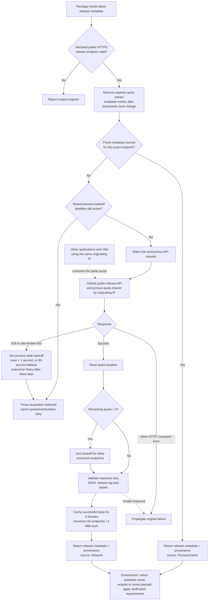

# GitHub latest-release discovery

`GitHubReleaseApi` package operations share release discovery in
`modules/RIDE-Packages.psm1`. The declared publisher endpoint and repository
remain authoritative; selecting another package does not create a separate quota.
Artifact versions, publisher repository checks and available digest/checksum
verification still apply to every acquisition, including cached payloads.

## Anonymous cache and backoff flow

Release metadata caching and rate-limit handling happen before downstream
publisher-asset acquisition. The cache and backoff are shared across release
endpoints within one package-module instance, not across processes or VMs.



Fresh cached metadata remains usable during backoff. An uncached lookup fails
immediately while the deadline is active: no sleeping, automatic retry, extra
quota request or expired-data fallback. A later caller can retry after the
deadline. The versioned installer payload cache is separate from this metadata
cache, and host preflight cannot reserve GitHub quota for a later guest request.
The implementation is in
[`Get-RideGitHubReleaseMetadata`](../modules/RIDE-Packages.psm1).

## Freshness and provenance

Successful release bodies are reused for **five minutes**, keyed by the exact
public release endpoint and authentication context, within the current package module instance and
PowerShell process. At expiry, resolution queries the publisher again; it never
falls back to expired data after a network or quota failure. Reloading the module,
starting another PowerShell process or restoring a VM clears this memory cache.
No release metadata is written to a persistent discovery cache or forwarded
from the host into a guest.

The cache retains at most **64 endpoints**, with at most **two MiB** per response.
Expired entries are removed before lookup and the oldest entry is evicted when
full. Cached input is serialized so consumers cannot alter subsequent selections.
A backwards clock change invalidates affected entries rather than extending
their lifetime. Latest means the publisher metadata fetched within this explicit
freshness window; a release published during that window is selected after expiry.

Resolved and saved artifact objects, observation-library entries and artifact
`.ride.json` sidecars include optional `ReleaseMetadata`:

| Field | Meaning |
| --- | --- |
| `ApiUri` | Declared public GitHub release API endpoint |
| `AcquisitionKind` | `Network` or `ProcessCache` for release metadata |
| `RetrievedAtUtc` | Successful metadata fetch time, preserved on cache reuse |
| `ExpiresAtUtc` | End of the five-minute freshness window |
| `RemainingQuota` | Response-header observation; null when unavailable |
| `ResetAtUtc` | Response-header UTC reset observation; null when unavailable |
| `AuthenticationMode` | `Anonymous` or `PAT`; absent in older evidence means unspecified |

This metadata source is separate from the existing top-level `AcquisitionKind`,
which reports whether the installer payload was downloaded or reused from the
versioned artifact cache. Quota observations describe the fetch response; they
are not a promise that other clients have left the shared budget unchanged.
Older observations and non-GitHub providers remain valid without this field.

## Exhaustion and recovery

The unauthenticated API limit is shared by originating IP. RIDE tracks observed
release backoff across all release endpoints in this module instance. Fresh
metadata already held in memory may still be used without a request. An endpoint
without fresh metadata fails with **acquisition deferred**, remaining quota,
reset UTC and the earliest retry time. The error prevents payload acquisition or
installation success; it is not a passing or complete run.

- A successful response with zero remaining quota prevents additional uncached
  release requests until after its reset time.
- HTTP 403 with zero remaining quota, or HTTP 429, records shared backoff.
  A secondary-limit HTTP 403 is recognized from `Retry-After` or the API's
  rate-limit error detail. Ordinary permission/transport errors retain their
  original failure and do not become quota exhaustion.
- Primary exhaustion waits until after the reported reset. Secondary exhaustion
  respects `Retry-After`; missing, malformed or expired timing information uses
  a conservative one-minute backoff. If both constraints apply, the later wins.
- RIDE does not sleep, spin, automatically retry, call an extra quota endpoint,
  substitute another publisher or use expired release data. A caller can retry
  after the reported deadline; the next uncached lookup makes one new request.

Separate processes and VMs do not share RIDE's memory state, although their
network traffic may share GitHub's quota. An external client can exhaust quota
after host preflight. Repeated VM runs therefore remain conditional on publisher
availability; a deferred acquisition must be recorded as failed acceptance.

Anonymous requests use public HTTPS release endpoints without authentication,
query strings or fragments. RIDE never discovers environment, GitHub CLI or
runner tokens. Explicit PAT authentication is described below; live authenticated
VM acceptance remains pending. Authentication rejection never falls back to anonymous.

GitHub documents [response quota headers and primary/secondary backoff](https://docs.github.com/en/rest/using-the-rest-api/rate-limits-for-the-rest-api)
and [serial requests and efficient caching](https://docs.github.com/en/rest/using-the-rest-api/best-practices-for-using-the-rest-api).

## Explicit PAT enrollment and selection

Use an expiring fine-grained PAT with public repository access and no additional
permissions. A scope-free classic PAT also supports this public-only workflow.
Do not grant private repository or write permissions for RIDE. GitHub documents
[public release access](https://docs.github.com/en/rest/releases/releases#get-the-latest-release)
and the permission-free fine-grained
[authenticated identity endpoint](https://docs.github.com/en/rest/users/users#get-the-authenticated-user).

Run enrollment as the account that will execute RIDE, including elevated runs
and scheduled tasks. The prompt hides input; do not paste a token into commands,
chat, profiles or environment variables. Replace the example cutoff with a future
UTC time no later than the PAT's actual GitHub expiration:

```powershell
.\tools\Manage-RideGitHubCredential.ps1 Add -Name public-releases -ExpiresAtUtc '2026-11-01T00:00:00Z'
.\tools\Manage-RideGitHubCredential.ps1 List
.\tools\Manage-RideGitHubCredential.ps1 Test -Name public-releases
.\ride.ps1 download package.7zip -GitHubAuthentication PAT -GitHubCredentialReference public-releases
```

`download`, `install`, `apply` and `restore` accept these options. They apply only
to GitHub latest-release metadata, including a package reinstall during restore.
Other providers, including the immutable GitHub file provider, remain unchanged.
Both options must be supplied for PAT mode; Anonymous forbids a reference.
Tab completes modes and enrollment names without decrypting credentials.
Inspection and `-WhatIf` do not retrieve credentials or make authentication calls.

Enrollment makes one `GET /user` request before storing a credential. Add refuses
an existing name; Replace requires an existing name and validates the replacement
before atomic replacement. List reads nonsecret metadata only. Test makes one
explicit identity request. Remove deletes local enrollment without GitHub revocation.
Add/Replace/Remove and the management script's Test support `-WhatIf`.

Credentials use Windows CurrentUser DPAPI and account/SYSTEM ACLs below
`%LOCALAPPDATA%\RIDE\Credentials\GitHub`, outside checkout snapshots and exported
RIDE state. Each record has a schema, purpose, expiration cutoff and random revision.
Authoritative metadata and token are protected together. The local cutoff does not
prove GitHub's actual expiration or permissions; GitHub can reject a revoked or
expired token earlier. Re-enroll for a different executing account. DPAPI protects
storage, not a compromised process executing as the same account.

PAT requests use a separate HttpClient with redirects, cookies and ambient Windows
credentials disabled. Only HTTPS `api.github.com` on the default port is accepted.
Enrollment/testing uses `/user`; discovery verifies `/repos/{owner}/{repo}` is public
before reading `/releases/latest`. Two requests are therefore needed for a cold
authenticated release lookup. Warm release entries also retain that visibility
check for the five-minute window. No token is sent to payload, checksum, signature,
redirect or installer destinations. Private repository acquisition is unsupported.

Anonymous and PAT cache keys are separate; PAT keys also separate executing Windows
identity and credential revision. The package module retains at most 64 release
entries across modes. Credential availability and local expiry are checked before
PAT cache reuse. Account backoff is keyed by the numeric GitHub user ID, so rotating
tokens does not create another allowance. At most 64 active account deadlines are
held; saturation refuses new requests rather than evicting a deadline. There is no
cross-process quota reservation. The existing freshness, payload checks, no-retry
policy and header-driven deferral still apply.

Errors expose stable `RideGitHub.*` categories and sanitized messages. Saved release
provenance adds only AuthenticationMode, never enrollment names, account IDs,
credential revisions, fingerprints or encrypted records. Treat saved quota values
as observations, not remaining-budget guarantees.

## Disposable guest authentication

Guest authentication is explicit per request and initially restricted to the
`GitHubAuthentication` suite. This suite downloads and verifies the catalog's
7-Zip payload without installing it. UnitOnly and broad suites refuse PAT mode.

1. Enroll a separate short-lived PAT with `-Purpose VmTest` under the registered
   host account. An Interactive enrollment is refused for guest delivery.
2. Use controller configuration schema 2 and set `GuestGitHubCredentialReference`
   to that nonsecret enrollment name. Refresh protected controller files through
   registration while the controller is idle. Registration advertises
   `GitHubPatGuestV1` and records all seven installed helper hashes. Existing
   schema-1 configurations/requests remain anonymous; old controllers cannot accept PAT requests.
   PAT delivery refuses runners invoked from a mutable checkout; use the registered
   protected installation even when selecting PowerShell Direct.
3. Select an isolated reviewed source without the active settings fixture. Keep
   VM/checkpoint/account/source/ISO pins and existing package pauses intact.
4. Use the installed client, explicitly selecting mode:

```powershell
& $installedClient -ConfigurationPath $configuration -IntegrationSuite GitHubAuthentication -GuestGitHubAuthentication PAT
& $installedClient -ConfigurationPath $configuration -IntegrationSuite GitHubAuthentication -GuestGitHubAuthentication Anonymous
```

The controller pins the credential revision so a rotation between preflight and
delivery fails before sending a different credential. PowerShell Direct or encrypted
Negotiate/Kerberos WSMan carries a SecureString, never a token in command arguments.
The guest seals it for its executing SID below
`%LOCALAPPDATA%\RIDE\TransientCredentials\<RunId>`, with the earlier of the request
deadline or credential expiry. Only a run reference and expected SID reach the
fresh test process. No lease is baked into the clean checkpoint.

Guest and host finally paths remove the lease. The controller restores the pinned
checkpoint, runs a bounded credential-absence probe under the delivery identity,
then restores it again and leaves the guest Off. Unverified recovery blocks further
requests. An interrupted worker retains the existing recovery block behavior.
Reset is cleanup, not token revocation.

For recovery acceptance, select `-GitHubTestScenario FailAfterDelivery` or
`WaitForTimeout`; expected Failed/TimedOut results remain failures, and evidence
must prove the intended phase was reached. Never count an earlier Pester or setup
failure as the requested fault scenario.

PAT runs scan the entire retained run directory, including snapshots and sidecars,
then publish only a separate scanned `export` directory. Scanning rejects token
representations, credential-record markers, unreadable files, links and oversized
evidence. A correlated `export-safety.json` pins every file hash; CI refuses missing,
modified or extra files. Raw evidence remains local if scanning fails. Restrict
access and revoke the test PAT if actual exposure is detected; checkpoint reset
cannot revoke it.

CI selection uses nonsecret `RIDE_VM_GITHUB_AUTHENTICATION=PAT` plus
`RIDE_VM_PILOT_MODE=GitHubAuthentication` for the existing pilot, or
`RIDE_VM_INTEGRATION_SUITE=GitHubAuthentication` after the separate main cutover.
Defaults remain Anonymous and the existing suite choices. No CI token or secret
environment variable is forwarded.

## Authentication acceptance status

The source implementation and synthetic Windows tests do not constitute live PAT
acceptance. Required live evidence remains: anonymous/PAT focused acquisition on
Windows 11 and Server 2025; real digest/cache observations; execution-account and
cross-account DPAPI behavior; post-delivery failure and timeout; bounded collection;
post-reset absence; safe evidence export; pinned-source/hash and idle-state checks.
Dedicated test credential enrollment and protected controller refresh are separate
operational steps. Existing anonymous bridge evidence is retained on its original
baseline. Broad PAT Full runs, controller certification and default-branch cutover
remain separate gates.

## Validation and cutover

`tests/GitHubReleaseDiscovery.Tests.ps1` uses mocked HTTP/time and isolated
payloads for freshness, expiry, shared exhaustion, recovery, response-header
formats, invalid endpoints/responses, cache bounds and retained digest/provenance.
Native workstation runs exclude the existing `WindowsIntegration` live-registry
test. Disposable guests and hosted Windows CI run the full applicable suite.

Consecutive Full VM runs on Windows 11 and Server 2025 must retain source hashes,
correlated guest/controller results, acquisition evidence and checkpoint cleanup.
Check for competing migration work before each submission. Default-branch VM
testing and `master` publication remain deferred until their separate cutover
and controller certification requirements are satisfied.

The [active controller ledger](migrations/controller-certification.md#resume-near-v3-release-candidate)
owns accepted baselines, remaining RC gates and the procedure for resuming testing.
