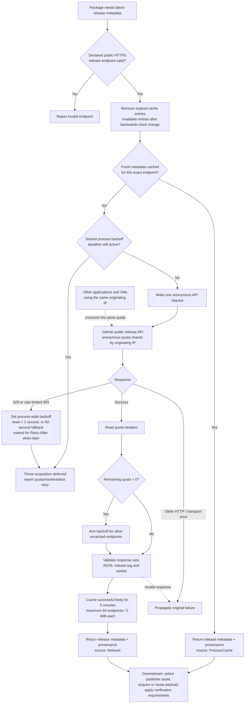

# GitHub latest-release discovery

`GitHubReleaseApi` package operations share release discovery in
`modules/RIDE-Packages.psm1`. The declared publisher endpoint and repository
remain authoritative; selecting another package does not create a separate quota.
Artifact versions, publisher repository checks and available digest/checksum
verification still apply to every acquisition, including cached payloads.

## Cache and backoff flow

Release metadata caching and rate-limit handling happen before downstream
publisher-asset acquisition. The cache and backoff are shared across release
endpoints within one package-module instance, not across processes or VMs.

Fresh cached metadata remains usable during backoff. An uncached lookup fails
immediately while the deadline is active: no sleeping, automatic retry, extra
quota request or expired-data fallback. A later caller can retry after the
deadline. The versioned installer payload cache is separate from this metadata
cache, and host preflight cannot reserve GitHub quota for a later guest request.
The implementation is in
[`Get-RideGitHubReleaseMetadata`](../modules/RIDE-Packages.psm1).

## Freshness and provenance

Successful release bodies are reused for **five minutes**, keyed by the exact
public release endpoint, within the current package module instance and
PowerShell process. At expiry, resolution queries the publisher again; it never
falls back to expired data after a network or quota failure. Reloading the module,
starting another PowerShell process or restoring a VM clears this memory cache.
No release metadata is written to a persistent discovery cache or forwarded
from the host into a guest.

The cache retains at most **64 endpoints**, with at most **two MiB** per response.
Expired entries are removed before lookup and the oldest entry is evicted when
full. Cached input is serialized so consumers cannot alter subsequent selections.
A backwards clock change invalidates affected entries rather than extending
their lifetime. Latest means the publisher metadata fetched within this explicit
freshness window; a release published during that window is selected after expiry.

Resolved and saved artifact objects, observation-library entries and artifact
`.ride.json` sidecars include optional `ReleaseMetadata`:

| Field | Meaning |
| --- | --- |
| `ApiUri` | Declared public GitHub release API endpoint |
| `AcquisitionKind` | `Network` or `ProcessCache` for release metadata |
| `RetrievedAtUtc` | Successful metadata fetch time, preserved on cache reuse |
| `ExpiresAtUtc` | End of the five-minute freshness window |
| `RemainingQuota` | Response-header observation; null when unavailable |
| `ResetAtUtc` | Response-header UTC reset observation; null when unavailable |

This metadata source is separate from the existing top-level `AcquisitionKind`,
which reports whether the installer payload was downloaded or reused from the
versioned artifact cache. Quota observations describe the fetch response; they
are not a promise that other clients have left the shared budget unchanged.
Older observations and non-GitHub providers remain valid without this field.

## Exhaustion and recovery

The unauthenticated API limit is shared by originating IP. RIDE tracks observed
release backoff across all release endpoints in this module instance. Fresh
metadata already held in memory may still be used without a request. An endpoint
without fresh metadata fails with **acquisition deferred**, remaining quota,
reset UTC and the earliest retry time. The error prevents payload acquisition or
installation success; it is not a passing or complete run.

- A successful response with zero remaining quota prevents additional uncached
  release requests until after its reset time.
- HTTP 403 with zero remaining quota, or HTTP 429, records shared backoff.
  A secondary-limit HTTP 403 is recognized from `Retry-After` or the API's
  rate-limit error detail. Ordinary permission/transport errors retain their
  original failure and do not become quota exhaustion.
- Primary exhaustion waits until after the reported reset. Secondary exhaustion
  respects `Retry-After`; missing, malformed or expired timing information uses
  a conservative one-minute backoff. If both constraints apply, the later wins.
- RIDE does not sleep, spin, automatically retry, call an extra quota endpoint,
  substitute another publisher or use expired release data. A caller can retry
  after the reported deadline; the next uncached lookup makes one new request.

Separate processes and VMs do not share RIDE's memory state, although their
network traffic may share GitHub's quota. An external client can exhaust quota
after host preflight. Repeated VM runs therefore remain conditional on publisher
availability; a deferred acquisition must be recorded as failed acceptance.

Requests use public HTTPS release endpoints without credentials, query strings
or fragments. No environment token, runner credential or authentication header
is read or forwarded. Optional authentication is [approved v3 scope](MIGRATION-PLAN.md#optional-github-authentication-v3-scope)
with implementation and acceptance pending. It is not an implicit fallback or
implemented behavior in the current resolver.

GitHub documents [response quota headers and primary/secondary backoff](https://docs.github.com/en/rest/using-the-rest-api/rate-limits-for-the-rest-api)
and [serial requests and efficient caching](https://docs.github.com/en/rest/using-the-rest-api/best-practices-for-using-the-rest-api).

## Validation and cutover

`tests/GitHubReleaseDiscovery.Tests.ps1` uses mocked HTTP/time and isolated
payloads for freshness, expiry, shared exhaustion, recovery, response-header
formats, invalid endpoints/responses, cache bounds and retained digest/provenance.
Native workstation runs exclude the existing `WindowsIntegration` live-registry
test. Disposable guests and hosted Windows CI run the full applicable suite.

Consecutive Full VM runs on Windows 11 and Server 2025 must retain source hashes,
correlated guest/controller results, acquisition evidence and checkpoint cleanup.
Check for competing migration work before each submission. Default-branch VM
testing and `master` publication remain deferred until their separate cutover
and controller certification requirements are satisfied.
