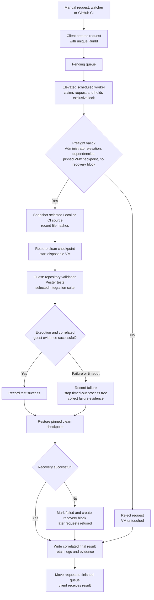

# AutomatedLab task controller

The authentication candidate adds schema-2 configuration, the `GitHubPatGuestV1`
capability and two protected helper modules. Existing schema-1 requests remain
anonymous. PAT is explicit per request and limited to `GitHubAuthentication`;
read the [credential delivery and evidence workflow](../../docs/github-release-discovery.md#disposable-guest-authentication)
before refreshing a controller. This source change does not promote the installed
controller baseline or its existing certification status.

This is an **opt-in controller with scoped acceptance**; broader stable-
configuration certification remains open. The
[active acceptance and RC resumption ledger](../../docs/migrations/controller-certification.md#resume-near-v3-release-candidate)
owns current baselines, constraints and unresolved gates; dated records below
retain their original scope. Existing direct VM commands continue to work. Do
not redirect the current Windows 11 lab until an agreed cutover.

## Controller workflow

The client submits a correlated request; the registered elevated worker runs it
under an exclusive controller lock. The simplified flow below separates guest
test results from final checkpoint recovery.



Failures before touching the VM skip checkpoint recovery but still produce a
final result. Interrupted running requests also create a recovery block. A
passing guest result can become a failed final result when checkpoint recovery
fails. A timeout process-termination failure creates a block as well; explicit
recovery is required before more work.
No accepted controller configuration is implied merely by this workflow.

Host UAC configuration is outside test-controller validation. Registration and
execution neither read nor compare it, and a disabled UAC configuration does not
block testing. The controller still requires an elevated process to manage its
disposable VM; it never enables, disables or repairs UAC. Guest checks that
exercise UAC-dependent behavior remain specific to their selected scenario.

New registration evidence and run results omit the former optional host UAC
observation fields. Existing records remain historical evidence; no result or
configuration rewrite is needed, and checkpoint recovery does not depend on
those fields. Refresh an installed controller through registration while idle
to adopt the updated source and record its new file hashes.

The implementation is in [the task worker](Invoke-RideVmTestTaskWorker.ps1) and
[`Invoke-RideAutomationRequest`](RIDE.TestAutomation.psm1).

## Handoff checkpoint, 2026-10-12

This starting checkpoint is historical; the follow-up sections below record
later results and the current publication gate.

At the starting handoff, the last pushed migration-branch commit was `003f2a8`. Hosted
[`Validate` run `38219385989`](https://github.com/tjuuljensen/ride-windows/actions/runs/38219385989)
passed on Windows PowerShell 5.1 and PowerShell 7. The VM job for that push was
skipped because the pilot flag was disabled at the time. Earlier GitHub unit-only
pilot request `98de728279d84a8ca67e1f1ad351e6e6` passed and uploaded evidence;
the Full GitHub pilot is still pending. The failed Full request
`10a427ee62684c00bca52d2c814a0a27` was stopped by a 7-Zip publisher API
rate limit after guest unit tests passed; it is not a successful integration run.

The operator later enabled the migration pilot variables, but their current
values must be checked before another push. Keep `RIDE_VM_TESTS_ENABLED=false`
and do not push a Full pilot while the publisher API reports zero remaining
requests. The most recent read-only preflight returned HTTP 403 and a reset of
2026-10-12 08:35:54 UTC (10:35:54 Europe/Copenhagen). That preflight also found
the Server VM Off, its pinned checkpoint unchanged, task Ready, queues empty,
and no recovery block. After the reset, check the API once, confirm the runner
is listening and the pilot mode is `Full`, then make a focused reviewed branch
push. Correlate its request, guest integration result, source hashes, uploaded
artifact, UAC values and post-run VM cleanup before recording acceptance.
Default-branch dispatch and `master` push acceptance remain deferred while v3
is under migration. Do not mark `evidence.json` validated based on these pilot
results alone. Detailed run IDs and limits are recorded below.

## Full pilot follow-up, 2026-10-12

The operator published `25a3a314a1f7861616c7cb734045c2eb541afedf` and
authorized continuation. The publisher preflight at 08:36:01 UTC returned
HTTP 200 with 59 of 60 requests remaining. The migration pilot was enabled
in `Full` mode, with `RIDE_VM_TESTS_ENABLED=false`.

[`VM run 38224889842`](https://github.com/tjuuljensen/ride-windows/actions/runs/38224889842)
attempt 1 failed before submitting a request because
`RIDE_AUTOMATION_CONFIGURATION` contained `true`. After the operator restored
the installed Server configuration path, attempt 2 submitted Full CI request
`575ec412969844438bfa5a3aa1812e51` at 08:42:16 UTC. All 210 source-manifest
hashes matched both the retained snapshot and the clean approved CI checkout
at `25a3a31`. The request finished at 09:05:22 UTC after 23 minutes 4 seconds.
Guest catalog validation passed, but Pester 5.7.1 on Windows PowerShell 5.1
reported 1,233 passed and eight failed out of 1,241 tests. The eight failures
match the hosted PowerShell 7 failures below. Integration did not start;
this is not a successful Full pilot or a publisher-rate-limit failure.

Cleanup, collection and guest state-collection errors were empty, as was the
collection-omissions array. Host UAC remained 1/5/1. Read-only native inspection
at 09:06:38 UTC found Server VM Off, task Ready, pending/running queues empty,
no recovery block, and the unchanged pinned checkpoint
`4a5b49ba-0795-480a-8d01-6f4f670577c8`.
All five protected controller files still matched the hashes in registration
evidence. Creating `acceptance.md` beside `evidence.json` was denied by the
protected directory's ACL; a local copy with registration hashes is retained
at `.local/automatedlab-controller/RIDESrv2025Test/acceptance.md` for an operator
to place alongside the installed evidence. No permissions were changed.

GitHub's upload step succeeded and retained artifact
[`ride-vm-575ec412969844438bfa5a3aa1812e51`](https://github.com/tjuuljensen/ride-windows/actions/runs/38224889842/artifacts/11737210190),
102,816 bytes, for the same migration branch and exact commit. Its recorded
SHA-256 digest is
`220c94e68d48b07f0ee4701639a33f1ab58b3d6d905aaec8b4125dde2a8068e0`.

[`Hosted Validate run 38224889892`](https://github.com/tjuuljensen/ride-windows/actions/runs/38224889892)
failed on PowerShell 7: 1,233 passed, eight failed, none skipped. The Windows
PowerShell job was cancelled. Failures include unavailable
`Get-RideCatalogContext` in registry-authoring tests and missing
`components/profiles/terminal-color-schemes.psd1` in copied test checkouts.

At this pilot submission, separate PowerShell profile acceptance was active on
Windows 11, so additional requests were deferred and that VM was left alone.
It subsequently completed on both targets; see the
[profile acceptance and continuation record](../../docs/archive/migrations/powershell-profile-acceptance.md).
The already-submitted Server pilot was monitored through host-side evidence;
its collection and checkpoint recovery were not interrupted. Correct the
unit regressions and verify the full suite before retrying the Full pilot,
after competing VM work finishes; correlate hosted validation with that retry.
Controller validation remains `NotValidated`;
default-branch dispatch, master publication and remaining acceptance stay deferred.

## Unit regression repair, 2026-10-12

The competing profile-acceptance chat finished before this follow-up. Read-only
host checks at 10:20:06 UTC found both disposable VMs Off, both controller tasks
Ready, empty pending/running queues and no recovery blocks. No new VM request
has been submitted during this repair.

Three fixture changes address the eight failures from `25a3a31`: import the
public library command after the engine reloads its nested dependencies, and
include `components/profiles` with both copied metadata checkouts. The existing
assertions and production handlers are unchanged. An isolated Git archive of
`25a3a31` plus only these three edited tests excludes unrelated working-tree
migration changes from validation and publication.

Native PowerShell 7.6.5 and Windows PowerShell 5.1.26100.9549 each passed all
101 focused checks and all 1,241 full-suite tests with zero failed or skipped.
Catalog
validation passed for 303 operations, three groups and five profiles, and the
three edited scripts parsed successfully. Pester's unused TestRegistry plugin
was disabled for local checks; temporary-directory publication required the
native session outside the filesystem sandbox. No integration suite ran.

Before publication, the verified pilot variables were enabled/Full with the
main switch disabled and the correct Server configuration path. These settings
are retained. After the full native regression checks passed, the authorized
focused migration-branch push can run hosted Validate and the Full pilot on the
same source. Verify publisher availability and host readiness immediately before
that push, then correlate both jobs and the VM evidence. At 10:50:12 UTC the
publisher returned HTTP 200 with 17 requests remaining and reset 11:36:25 UTC;
the Server VM was Off, task Ready, queues empty, no block, pinned checkpoint
unchanged and UAC 1/5/1. The runner listener was active and competing chats idle.
Controller validation, remaining
acceptance and master/default-branch publication remain deferred.

Commit `570a144db591d6e6ef82fe275da0283ca6dd79ea` published only the three
fixture repairs and this runbook's follow-up records. Unrelated migration work
remains in the local checkout. The push started
[`Validate 38238999041`](https://github.com/tjuuljensen/ride-windows/actions/runs/38238999041)
and [`Full VM pilot 38238999191`](https://github.com/tjuuljensen/ride-windows/actions/runs/38238999191).
The Server controller accepted Full CI request
`05f1359469af482390932470e007dc10` at 10:52:33 UTC. Hosted validation passed
all 1,241 tests on both editions, and the guest passed catalog validation and all
1,241 tests on Windows PowerShell 5.1.26100.33438 with Pester 5.7.1. Full
integration then failed acquiring 7-Zip with HTTP 403, retaining failed package
run `41745fc5c25841f9ba888b1ec7d872cb`. The request finished at 11:12:47 UTC
after 20 minutes 11 seconds; this is not Full acceptance.

Cleanup, collection and guest state-collection errors were empty; collection
omissions were empty. Host UAC remained 1/5/1. Native inspection at 11:16:15 UTC
found both VMs Off, both tasks Ready, queues empty, no recovery blocks and the
unchanged Server checkpoint ID. The upload succeeded with artifact
[`ride-vm-05f1359469af482390932470e007dc10`](https://github.com/tjuuljensen/ride-windows/actions/runs/38238999191/artifacts/11742163566),
102,707 bytes, SHA-256
`554b26a7d4e7c5263a23449ce760bb422da0c11292ec35c1b2dc82e2dfc397ac`.
All 210 staged source hashes matched the clean approved CI checkout at `570a144`
and the retained snapshot. No repository variables were changed and master was
not published. All five installed controller files still matched the registration
hashes; `evidence.json` remains `NotValidated`.

A single publisher check at 11:15:43 UTC confirmed HTTP 403 rate-limit
exhaustion. The last successful response reported reset at 11:36:25 UTC;
defer another Full push until after that time and check once for available quota.
The operator authorized committing and pushing all current changes after review
and testing. Complete-state native regression passed all 1,248 tests on each
edition with zero failures or skips: PowerShell 7.6.5 in 12 minutes 42 seconds,
Windows PowerShell 5.1.26100.9549 in 21 minutes 58 seconds. Both editions also
validated 303 operations, three groups, five profiles, all 106 PowerShell files
and current generated documentation. The accepted profile module matches the
hash recorded in its separate two-target acceptance. Ignored local configuration
and evidence are retained locally and excluded from publication.
Controller certification and default-branch cutover remain deferred. The
[rate-aware release discovery plan](../../docs/MIGRATION-PLAN.md#rate-aware-github-release-discovery-before-unattended-vm-ci-cutover)
remains required infrastructure work.

## Full migration-branch CI acceptance, 2026-10-12

The operator-authorized complete-state commit
`3ffe2941aa2969412b2411fdef3226b23ef8299b` published all 17 reviewed files.
The publisher preflight at 11:36:46 UTC returned HTTP 200 with 58 requests
remaining, after the preceding exhaustion. Before the push, both VMs were Off,
both tasks Ready, queues empty, no recovery blocks, the pinned Server checkpoint
unchanged, runner listener active and competing migration chats idle. Pilot
variables remained enabled/Full with `RIDE_VM_TESTS_ENABLED=false` and the
correct installed configuration path; no variable was changed.

[`Hosted Validate 38243799931`](https://github.com/tjuuljensen/ride-windows/actions/runs/38243799931)
passed all 1,248 tests per edition with zero failures or skips. Both jobs
validated 303 operations, three groups, five profiles and all 105 published
PowerShell files. The preceding local parser count of 106 also included the
ignored `dev/registry-migration-review/Invoke-RideVmSuite.ps1`; it was not
published or staged into this request.

[`Full VM pilot 38243799797`](https://github.com/tjuuljensen/ride-windows/actions/runs/38243799797)
submitted CI request `9706aaca6bab48cea35e7ebeb6a0eb14` at 11:37:33 UTC.
It ran from 11:37:36 to 11:54:18 UTC, about 16 minutes 42 seconds. Controller
and guest results both report Passed for the same request; UnitOnly is false,
both suite fields are Full, ValidationPassed and IntegrationPassed are true.
Pester 5.7.1 on guest Windows PowerShell 5.1.26100.33438 passed all 1,248 tests;
the retained XML reports zero failures, errors, skipped or not-run tests.
All 214 source hashes matched the retained snapshot and clean CI checkout at
`3ffe294`, including profile module 0.1.2 and its accepted two-target hash.

The Server-applicable Full scenarios passed, including real 7-Zip and Notepad++
installation/recovery. Acquisition retained 7-Zip 26.04 publisher evidence for
`7z2604-x64.exe`, SHA-256
`d54bf805f9f3704d1e8db2fa3498ae7ef2df0312b40b558e7c71c734430a665d`.
The transcript explicitly skips the Windows 11-only Explorer baseline and Git,
Git LFS, Joplin, ShareX, WinDirStat and PowerShell package scenarios not declared
for Server. Passing this pilot does not extend those support declarations or
establish a Windows 11 Full controller run.

Controller, cleanup, collection and guest state-collection errors were null.
Ten state JSON files, including three run manifests, were retained. Host UAC
remained 1/5/1. Native inspection at 11:55:08 UTC found both VMs Off, both tasks
Ready, queues empty, no recovery blocks and unchanged pinned Server checkpoint
`4a5b49ba-0795-480a-8d01-6f4f670577c8`.
GitHub uploaded
[`ride-vm-9706aaca6bab48cea35e7ebeb6a0eb14`](https://github.com/tjuuljensen/ride-windows/actions/runs/38243799797/artifacts/11745381286),
124,182 bytes, SHA-256
`8e54dd5c464556d20751bc7a7eb0738c8fb422aed6c4541d8c2d723a850e9a1c`,
for the exact branch and source commit.

This completes the Full migration-branch Server CI pilot. Overall controller
certification remains NotValidated: Windows 11 consecutive/locked/watcher runs,
remaining failure/recovery scenarios, default-branch dispatch and master push
acceptance remain deferred. Rate-aware release discovery is still required before
unattended default-branch cutover; success after quota reset does not resolve it.
Final result records are published in a documentation-only commit with
`[skip ci]`, using [GitHub's documented push-skip behavior](https://docs.github.com/en/actions/how-tos/manage-workflow-runs/skip-workflow-runs)
to avoid queuing a redundant VM request. No implementation changed after the
tested commit; master remains untouched and the main VM switch stays disabled.

## Release-discovery implementation validation, 2026-10-12

Package module 0.10.0 adds the
[bounded release discovery contract](../../docs/github-release-discovery.md).
Its reviewed SHA-256 is
`9D17295FB5460DA9578D7BC76EBDE08E18773A79AB935CC2B49484D0B6055E63`.
The existing publisher/digest checks remain in the acquisition path; new optional
ReleaseMetadata evidence distinguishes metadata reuse from payload cache use.
No host controller binary, credential, UAC policy or repository variable changed.

Native focused checks passed 124 selected tests per edition, including 29 new
discovery cases. Complete native regression passed 1,276 per edition with zero
failures or skips; the one WindowsIntegration live-registry test stayed excluded
on the workstation. The full suite will run in disposable guests and hosted CI.
Both editions passed catalog/profile/parser/generated-document validation:
303 operations, three groups, five profiles and 107 local PowerShell files,
including the previously documented ignored development harness. No ignored
local configuration, evidence or helper is published.

Read-only preflight at 14:31:28 UTC found both VMs Off, both tasks Ready, queues
empty, no recovery blocks, both worker locks available, both pinned clean
checkpoint IDs unchanged, runner listener active and host UAC 1/5/1. Other
migration chats were idle. A single publisher check at 14:35:01 UTC returned
HTTP 403, zero remaining and reset 14:36:55 UTC. Defer publication that triggers
VM work until a post-reset check confirms availability. Consecutive Full source
acceptance on both targets remains pending; master/default-branch cutover and
overall controller certification remain deferred.

## Release-discovery first Full CI acceptance, 2026-10-12

Complete-state commit `18d5f5baf1fc137ca9e144b9f0ad4be3818c909a` published
all reviewed changes. A post-reset publisher check at 14:38:58 UTC returned
HTTP 200 with 58 requests remaining; idle VMs/queues were rechecked before push.
[`Hosted Validate 38264537641`](https://github.com/tjuuljensen/ride-windows/actions/runs/38264537641)
passed all 1,277 tests per edition with zero failures, skips or not-run tests,
and validated all 106 published PowerShell files.

[`Full Server CI 38264537680`](https://github.com/tjuuljensen/ride-windows/actions/runs/38264537680)
submitted request `f5ae11428a5248009f891c8e5fee9ac3` at 14:40:08 UTC.
Execution 14:40:10-14:56:02 UTC passed: both results correlate the same Full
CI request, UnitOnly=false, guest validation and integration passed, Pester
5.7.1 on Windows PowerShell 5.1.26100.33438 passed all 1,277 tests. The retained
XML reports zero failures/errors/skips/not-run tests. All 216 source hashes
matched snapshot and clean approved CI checkout at `18d5f5b`, including the
reviewed package-module hash.

Real 7-Zip 26.04 and Notepad++ 8.9.8.1 acquisition evidence retained the new
ReleaseMetadata API URI, Network source, original fetch time and five-minute
expiry, with matching provider digests. Their API response quota observations
were respectively 13 and 12 remaining; both reported reset 15:37:05 UTC.
Payload cache use remains a separate evidence field. Applicable Server Full
scenarios passed; previously declared platform exclusions remain unchanged.

Controller, cleanup, collection and guest state-collection errors were null;
ten state JSON files were retained. Native postflight at 14:57:13 UTC found
both VMs Off, both tasks Ready, queues empty, no blocks, unchanged pinned clean
checkpoint IDs and UAC 1/5/1. GitHub uploaded
[`ride-vm-f5ae11428a5248009f891c8e5fee9ac3`](https://github.com/tjuuljensen/ride-windows/actions/runs/38264537680/artifacts/11754039820),
131,116 bytes, SHA-256
`03cc9c243cfc0046629c1829d38fdeaa6e9282360bdc7b5f0968c97e20525037`,
for the exact migration branch/source commit.

A single real host preflight through the new resolver at 14:59:33 UTC reported
acquisition deferred, remaining zero, reset 15:37:05 UTC and earliest retry
15:37:06 UTC. It did not download a payload or retry. Further submissions wait
for quota recovery. Two consecutive Full runs per target remain pending; only
the first Server run is accepted here. Overall controller status stays
NotValidated, master remains untouched, and all repository variables are unchanged.

## Release-discovery repeated Server quota failure, 2026-10-12

One post-reset host lookup at 15:43:54 UTC succeeded with 44 requests remaining
and reset 16:37:16 UTC. Other migration chats were idle; native preflight found
both VMs Off, both tasks Ready, empty queues, no blocks, available worker locks,
unchanged pinned clean checkpoint IDs and UAC 1/5/1. Approved CI checkout
`18d5f5baf1fc137ca9e144b9f0ad4be3818c909a` remained clean and unchanged.

Ordinary-shell CI-source Full request `a51320cf5d1e47a0ad13c5c13ebfc41c` ran
15:44:37-16:00:25 UTC. All 216 source hashes and the reviewed package-module
hash matched snapshot and published checkout. Guest validation and 1,277/1,277
tests passed; XML failures/errors/skips/not-run counts were zero. Integration
failed before 7-Zip acquisition: GitHub quota zero, reset 16:37:16 UTC, earliest
retry 16:37:17 UTC. The new resolver explicitly deferred acquisition without
expired metadata, payload download or automatic retry. No successful real
release observation was retained for this request; it is failed acceptance.

Controller status was Failed with the correlated guest failure; cleanup,
collection and guest state-collection errors were null. Three partial state
JSON files, including one run manifest, were retained. Native postflight at
16:01:25-16:02:27 UTC found both VMs Off, both tasks Ready, queues empty,
both worker locks available, no blocks, pinned IDs unchanged and UAC 1/5/1.
This installed-client submission used the approved CI source but has no new
GitHub workflow dispatch or uploaded workflow artifact.

The earlier Server pass remains valid, but this failure interrupts consecutive
acceptance. Two consecutive Full runs per target remain pending. Quota may
change between host preflight and guest integration; its traffic source is not
established. A native unit network-isolation investigation subsequently passed
all 1,276 selected Windows PowerShell tests in 18 minutes 12.84 seconds, with
HTTP cmdlet proxy defaults confined to a closed loopback endpoint. The one
workstation live-registry test was excluded. A read-only host connection sample
while both VMs were Off found an active VS Code API connection; this does not
attribute the quota drain, and no unrelated process was stopped. Do not
submit another acquisition before the reported retry time. Master, repository
variables, protected controller binaries and overall NotValidated status remain
unchanged. Historical locked/watcher acceptance is retained separately from
the current-source release-discovery and default-branch certification gates.

## Windows 11 Full quota failure and collector follow-up, 2026-10-12

Native preflight at 16:36:06 UTC found both VMs Off, tasks Ready, queues empty,
locks available, pinned clean checkpoint IDs unchanged and UAC 1/5/1. Other
migration work was documentation review. One post-reset host release lookup at
16:37:35 UTC returned 58 remaining, reset 17:37:26 UTC. This task's temporary
GitHub browser tab was closed; the run used its installed client without workflow
API polling. CI checkout remained frozen at `18d5f5b`.

Ordinary-shell CI-source Full request `554bf0cb1598406f852d53ea1d5ca26b` ran
16:38:15-17:07:47 UTC. All 216 source hashes and the reviewed package-module hash
matched. Guest Windows 11 Enterprise Evaluation, build 26300, PowerShell
5.1.26100.9444, Pester 5.7.1 passed validation and 1,277/1,277 tests; XML reports
zero failures/errors/skips/not-run. Setting round trips preceded the failure,
with lid-close cases explicitly excluded because the VM exposes no lid setting.
7-Zip acquisition deferred on quota zero: reset 17:37:26 UTC, retry no earlier
than 17:37:27 UTC. There was no real successful release observation or automatic
retry. Full integration and repeated two-target acceptance remain failed/pending.

Guest state collection had no error, but bounded partial collection timed out
after 60 seconds. Summary/XML/transcript and 791 state JSON files, including
395 manifests, were already retained by the main export. Those counts include
the state available to export; they do not establish request ownership for every
record. Checkpoint cleanup succeeded with UAC unchanged. At 17:08:59 UTC both
VMs were Off, tasks Ready, queues empty, locks available, no blocks, both pinned
IDs unchanged. This local request has no new GitHub workflow/upload artifact.

Collector source 0.4.0 skips byte-identical files already exported by the main
runner, using a single guest SHA-256 enumeration and local hash comparison.
Changed/missing files are copied independently; unavailable files retain omission
reporting. The worker still stops collection after 60 seconds to protect recovery.
All 71 mocked controller tests passed per edition, including new large-export,
same-length-change and unavailable-file regressions; repository validation passed
on both editions. Live verification is pending: protected Server and Windows 11
collectors are still 0.3.0 and 0.2.0. Refresh through elevated registration while
both controllers are idle; do not overwrite binaries or weaken ACLs manually.
This calling process has a non-elevated OS token. Overall status stays
NotValidated; no master, repository-variable or new target-support change was made.

## Published Server acceptance and controller refresh, 2026-10-13

Published source `a15647590a1324681bbe4a69cbb55e498a623522` passed
[hosted validation](https://github.com/tjuuljensen/ride-windows/actions/runs/38342901538),
1,280 tests per edition with zero failures/skips/unrun tests.
[Full Server CI](https://github.com/tjuuljensen/ride-windows/actions/runs/38342901443),
request `bade4fd6631e4283a326a05c47fcc7e0`, passed
03:42:02-03:58:58 UTC: validation, all 1,280 guest tests and Full integration.
All 217 snapshot/CI source hashes matched. Collection, guest-state export and
checkpoint cleanup succeeded with unchanged UAC. Fresh 7-Zip 26.04 and
Notepad++ 8.9.8.1 network metadata retained matching publisher digests, with
14/13 requests remaining and reset 04:42:59 UTC. Ten retained state JSON files
include three manifests. Uploaded artifact `11788600887` is 131,331 bytes,
SHA-256 `2226dae3aae4c56957aba48be99960a2beffa2e725004ca41db5c8105cadc40f`.

An elevated refresh attempt stopped before registration at 03:44:42 UTC because
the Server VM was in use. After CI cleanup, the same guarded helper refreshed
both controllers through their existing installed JSON at
03:59:50-04:02:23 UTC. Both now report collector **0.4.0**, SHA-256
`57DFFD7B437B180C9136DBC3F4AE6C244915706F05095F56384EB15A476215C2`.
All five installed files match reviewed source; VM/checkpoint/account/ISO hashes
and repository paths are preserved. Both VMs are Off, tasks Ready, queues empty,
worker locks available and no recovery blocks. Registration remains NotValidated.
The preceding passed Full request used Server collector 0.3.0, so newly installed
failure-path behavior still needs live acceptance; consecutive two-target Full
acceptance and certification remain open.

AutomatedLab initialization during refresh logged a caught GitHub quota error.
Installed AutomatedLabCore 5.61.0 contains an optional release-version request
on module import, controlled by `AutomatedLab.DisableVersionCheck`. This explains
an additional request path, not all quota consumption. No global dependency
configuration or credential forwarding was changed, and no further Full request
was submitted after the exhaustion observation. Master and repository variables
remain unchanged.

## Focused installed collector failure acceptance, 2026-10-13

Run `13eb2e6239c444e6b3eefa8a79d19a3f`, 04:11:25-04:16:40 UTC, passed
against the pinned Windows 11 VM with the installed collector **0.4.0**, SHA-256
`57DFFD7B437B180C9136DBC3F4AE6C244915706F05095F56384EB15A476215C2`.
The exclusive controller lock was held while a controlled guest failure fixture
preseeded host evidence, changed a same-length file, added a missing file and
locked the guest transcript. The installed `Save-RideAutomationFailureEvidence`
launcher completed collection in **36.1126535 seconds**, inside its unchanged
60-second limit. All 800 identical fixture JSON files retained their hashes and
timestamps, changed/new bytes arrived, and the pre-exported transcript survived
with exactly one omission reported. The host export contains 806 fixture files.

The test invoked the installed failure launcher directly; it did not submit a
queued Full request, run operation handlers or acquire publisher packages. The
helper's optional AutomatedLab version check was disabled only in that process;
no dependency configuration was persisted. The correlated helper, logs and result
remain under `.local/collector-failure-live/`; helper SHA-256 is
`8EF90C84999340234D71EDB4A7C25A08FF97DA6DCD4231314ABAF5CAD6EF7430`.
Checkpoint cleanup succeeded, UAC stayed 1/5/1, and both VMs are Off, controllers
Ready, queues empty, locks available and no recovery blocks. This accepts the
focused Windows 11 collector failure path; overall status remains NotValidated.

A single task follow-up is scheduled for **06:43 Europe/Copenhagen on
2026-10-13**, after the reported 04:42:59 UTC reset. It will check current quota,
source/controller hashes and competing VM work before one Full Windows 11
CI-source request. Unavailable quota or occupied controllers defer submission;
there is no duplicate request or repeated API polling scheduled. Full Windows 11,
consecutive two-target acceptance and certification remain open.

## Scheduled Full Windows 11 failure collection, 2026-10-13

The single scheduled follow-up checked publisher metadata at 04:44:21 UTC:
HTTP 200, 7-Zip 26.04, quota **45** remaining, reset **05:43:13 UTC**. Both
controllers were idle, all installed file hashes matched and CI checkout was
clean at `a15647590a1324681bbe4a69cbb55e498a623522`. Newer unfinished settings
edits in the working checkout were preserved and excluded from this test.

Full CI-source request `45682bfb744849beb7b5b2bd1733cc15`,
04:44:46-05:17:34 UTC, passed validation and **1,280/1,280 guest Pester tests**
on Windows 11 Enterprise Evaluation build 26300, PowerShell 5.1.26100.9444.
All 217 source hashes matched; XML reports no failures/errors/skips/unrun tests.
Pre-package setting round trips completed, with lid AC/DC cases explicitly
unavailable in this VM. Integration failed before 7-Zip payload acquisition:
quota **0**, reset 05:43:13 UTC, earliest retry **05:43:14 UTC**, without expired
metadata or automatic retry. No successful release observation belongs to this run.

Installed collector **0.4.0**, SHA-256
`57DFFD7B437B180C9136DBC3F4AE6C244915706F05095F56384EB15A476215C2`,
successfully completed the actual failure path within the unchanged 60-second
bound. CollectionError, guest-state export error and cleanup error are null;
collection-errors.log and the omission list are empty. Summary/XML/transcript
and 791 retained state JSON files, including 395 manifests, are preserved;
retained counts do not establish request ownership of every saved file. UAC
stayed 1/5/1. Both VMs are Off, controllers Ready, queues empty, locks available,
no blocks and checkpoint IDs unchanged. This accepts real bounded collection
of the large export that previously timed out, alongside the focused fixture.

This local CI-source request has no new GitHub workflow or upload artifact.
No additional publisher polling, host-token forwarding, global configuration,
repository-switch/master change or new Windows target-support claim followed.
The single follow-up is complete with no new request or automation. New settings'
manual VM-acceptance hold remains separate. Full Windows 11 package acceptance,
repeated two-target acceptance and overall NotValidated certification remain open.

## Recurring bridge Full Windows 11 attempt, 2026-10-13

One anonymous 7-Zip metadata preflight at 05:46:13 UTC returned HTTP 200,
45 requests remaining and reset 06:43:22 UTC. Both controllers were idle and
their five installed files matched reviewed source. The approved CI checkout
was clean at `a15647590a1324681bbe4a69cbb55e498a623522`; newer settings
work in the shared working tree was excluded. CI-source Full request
`ef33b0ad1cf04029959590b02178d7d9` ran 05:46:41-06:23:44 UTC.
All 217 source hashes matched. Guest validation and 1,280 Pester tests passed,
with zero XML failures/errors/skips/not-run. Full integration failed at the
first 7-Zip release lookup: quota zero, reset 06:43:22 UTC, retry no earlier
than 06:43:23 UTC. No expired metadata, automatic retry, payload acquisition
or successful release observation was used. This is failed Full acceptance and
resets the consecutive-pass sequence.

The installed 0.4.0 collector retained summary/XML/transcript and 791 state
JSON files, including 395 manifests. It wrote an empty omissions list at
06:23:32 UTC but the launcher terminated the process at its 60-second bound,
so `CollectionError` records a timeout. The timing suggests session/process
teardown, but the exact slow step was not logged. Guest state export and
checkpoint cleanup succeeded, UAC stayed 1/5/1, both VMs returned Off, tasks
Ready, queues empty, locks available, no recovery blocks and pinned checkpoint
IDs unchanged. The failure therefore does not certify bounded collection.

Collector 0.4.1 adds copy/teardown timing markers; controller module 0.4.3
allows a still-bounded 90 seconds and sets AutomatedLab's optional version
check off only in its process before import. The collector launcher tests passed
71/71 under Windows PowerShell 5.1. PowerShell 7 passed the three affected
launcher tests; its full 71-test file retained one unrelated queue-order failure
and is not reported as passing. Both protected controllers were refreshed
through guarded registration at 06:39:45-06:41:54 UTC; all five installed
hashes matched source, pinned fields stayed fixed, and both VMs were idle.
A new live failure-path run remains required to accept the revised bound.

During the first guarded refresh, before the process-only suppression was
installed, AutomatedLab attempted its optional GitHub version lookup inside
the recorded quota backoff and received a rate-limit error. Registration still
completed. This extra request was unintended and is retained as a backoff
process defect; no token or shared host configuration was used. The recurring
bridge heartbeat is set for 08:55 Europe/Copenhagen, after the guest-reported
retry deadline. New settings' manual VM-test hold remains separate. Full
Windows 11 package acquisition, consecutive two-target Full acceptance and
overall controller certification remain open.

## Revised collector real failure acceptance, 2026-10-13

After the guest-reported retry time, one anonymous 7-Zip preflight at 06:52:05
UTC returned HTTP 200, version 26.04, 31 requests remaining and reset 07:43:34
UTC. Both VMs were Off, tasks Ready, queues empty, locks available and unblocked;
all five installed files on each controller matched reviewed source. The approved
CI checkout remained clean at `a15647590a1324681bbe4a69cbb55e498a623522`.
Newer settings edits were excluded. Full CI-source Windows 11 request
`c08c77f026034547b4ceba4cfedc93af` ran through 07:21:50 UTC. All 217 source
hashes matched; validation and all 1,280 guest Pester tests passed with zero
XML failures/errors/skips/not-run. Integration again deferred at the first
7-Zip release lookup on quota zero: reset 07:43:34 UTC, retry no earlier than
07:43:35 UTC. No expired metadata, automatic retry, payload acquisition or
successful release observation occurred. This resets consecutive Full passes.

Installed collector 0.4.1 completed the real failure path: copy began
07:21:38.488 UTC, completed 07:21:48.134 UTC, and session teardown finished
07:21:48.169 UTC. CollectionError and cleanup error are null; collection-errors
and omissions are empty. Summary/XML/transcript and 791 retained state JSON
files, including 395 manifests, were preserved. Guest state export had no error.
UAC stayed 1/5/1; both VMs finished Off, tasks Ready, queues empty, worker locks
available, no recovery blocks and pinned checkpoint IDs unchanged. This accepts
the revised collector's real Windows 11 quota-failure path within its 90-second
bound. It does not accept package acquisition or certify the controllers.

The next recurring bridge check is 09:50 Europe/Copenhagen, after the guest's
09:43:35 retry deadline. One anonymous preflight and an idle-state check precede
at most one further request. The separate manual hold on new settings' VM tests
remains in force.

## GitHub quota bridge acceptance

The current anonymous bridge gate has two consecutive Full passes per target:
Windows 11 is 2/2 and Server 2025 is 2/2. The bridge heartbeat is disabled; see the
[completed pair gate](../../docs/archive/evidence/github-quota-bridge-pair-gate-complete-2026-10-13.md)
and [launcher diagnostic](../../docs/archive/evidence/github-quota-bridge-launcher-diagnostic-2026-10-13.md)
for dated run, recovery and provenance evidence. Controller certification and
default-branch cutover remain separate.

## Configuration contract

The finite integration selections include `ApplicationsBatch1` and
`ApplicationsBatch2`. The general client/VM runner and guest dispatcher share
those suite selections. With the `FocusedPortableV1` capability, the task client
also accepts `PSScriptTools` and `OfflineCaffeine` and routes them through the
protected portable runner, not the general guest dispatcher. See the
[focused preregistration procedure](README.md#focused-reviewed-portable-packages)
for its one-time elevated refresh and subsequent unelevated requests. A successful controller result
must correlate the requested suite with the guest summary. Source snapshots now
exclude `.local`, including machine-specific configuration and research samples;
refresh the protected controller through registration while idle.

| Item | Required configuration |
| --- | --- |
| Controller | 64-bit Windows PowerShell 5.1 |
| AutomatedLab | 5.61.0; AutomatedLab.Common 2.3.37 |
| Guest Pester | 5.7.1 |
| Host account | Existing lab administrator; same account for setup, task requests, watcher and CI runner |
| Task principal | `LogonType Interactive`, `RunLevel Highest` |
| Host session | Signed in, including locked; signed-out execution is unsupported |
| VM | Explicitly disposable Hyper-V VM; one controller configuration per VM |
| Checkpoint | `RIDE-clean-test-base`, pinned by ID during registration |
| Results/configuration | `%ProgramData%\RIDE\TestAutomation\<Name>` |
| Guest security | AutomatedLab defaults; guest UAC changes are outside this workflow |

Initial registration and the scheduled worker need an elevated process,
regardless of the host's UAC configuration. Subsequent requests run from ordinary
PowerShell. The configured account receives task read/execute access, while
task ownership, worker files and configuration remain administrative.
[Microsoft task security](https://learn.microsoft.com/en-us/windows/win32/taskschd/security-contexts-for-running-tasks).

AutomatedLab host remoting is a separate requirement. Version 5.61.0 checks
WinRM, CredSSP, wildcard TrustedHosts, fresh/saved credential delegation and
`AllowEncryptionOracle=2`. Its setup can modify these policies independently of
UAC configuration. Review and prepare them explicitly according to
[AutomatedLab's host-remoting documentation](https://automatedlab.org/en/latest/AutomatedLabCore/en-us/Enable-LabHostRemoting/).
The test controller checks existing preparation and fails instead of calling
`Enable-LabHostRemoting`. It also checks services before the upstream check,
which otherwise starts WinRM when stopped.

## 1. Prepare the host and a separate pilot

Finish existing jobs before changing host security or rebooting. Open 64-bit
**Windows PowerShell as administrator** and verify the actual token:

```powershell
[Security.Principal.WindowsPrincipal]::new(
  [Security.Principal.WindowsIdentity]::GetCurrent()
).IsInRole([Security.Principal.WindowsBuiltInRole]::Administrator)
Get-Service vmms, WinRM
Get-VMHost
```

Hyper-V Administrators membership alone is insufficient for AutomatedLab's
elevation checks. A restricted agent shell can report a different effective
token or service view; verify in the real host session before diagnosing a
missing Hyper-V installation.

No host UAC inspection or adjustment is required for controller setup or tests.
Host policy remains an independent administrator choice.

Install the pinned AutomatedLab version using the upstream installation
instructions. Its companion modules must also be 5.61.0; do not mix versions.
The controller records the versions actually loaded, including remaining
dependencies, and rejects later drift. Dependency upgrades require revalidation.

Use [the provisioning guide](automatedlab.md) for a **separate pilot**. For
example, use lab `RIDEWin11Pilot` and VM `RIDE-W11-Pilot`, never the active
`RIDE-Win11-Test` lab during acceptance. Select the exact OS name from your ISO.
Install guest updates, Pester 5.7.1 and create the clean checkpoint through that
guide. Automatic task runs neither provision labs nor update Windows.

## 2. Register once

Copy `automation.example.psd1` to a local file outside the repository. Fill in
the real checkout paths, ISO used for provisioning, and pilot VM ID:

```powershell
Get-VM -Name 'RIDE-W11-Pilot' | Select-Object Name, Id
Get-VMSnapshot -VMName 'RIDE-W11-Pilot' -Name 'RIDE-clean-test-base'

# Example local seed: C:\RIDE-Automation\pilot.psd1
.\tests\integration\Register-RideVmTestTask.ps1 `
  -ConfigurationPath 'C:\RIDE-Automation\pilot.psd1' -WhatIf
.\tests\integration\Register-RideVmTestTask.ps1 `
  -ConfigurationPath 'C:\RIDE-Automation\pilot.psd1' -Confirm:$false
```

Registration does not start tests or restore the VM. It creates `\RIDE\<Name>`
and installs the worker, runner, collector and client into a protected `bin`
directory. No host or guest password is stored by the task; AutomatedLab uses
its existing lab credentials. The generated `configuration.json` pins VM and
checkpoint identities. `evidence.json` records host build, UAC settings,
dependency versions, ISO SHA-256, VM settings and installed controller hashes.
Its validation status starts as `NotValidated`.

Installed controller processes use `-ExecutionPolicy Bypass` for that process
only so Windows PowerShell's script policy cannot stall an unattended run.
Machine/user execution policies and UAC settings are not changed. Use
`Get-Help <script path> -Full` for the public scripts' parameter help; finite
`-Action`, `-Source` and `-IntegrationSuite` values offer completion through their declared sets.

Re-register after reviewed controller changes. Do not do so during a run.
Keep local seed files outside source control and use the same account that owns
the existing lab. Setup stops rather than replacing an unrelated task.

## 3. Request tests from ordinary PowerShell

```powershell
$configuration = "$env:ProgramData\RIDE\TestAutomation\RIDEWin11Pilot\configuration.json"
$client = Join-Path (Split-Path -Parent $configuration) 'bin\Invoke-RideVmTestTask.ps1'
& $client -ConfigurationPath $configuration
# Faster diagnosis without real RIDE operations:
& $client -ConfigurationPath $configuration -UnitOnly
# Package-free acceptance of the twelve BCD/coordinated settings:
& $client -ConfigurationPath $configuration -IntegrationSuite SettingsBatch60Recovery
# Run the two remaining-settings batches separately:
& $client -ConfigurationPath $configuration -IntegrationSuite SettingsRemainingBatch1
& $client -ConfigurationPath $configuration -IntegrationSuite SettingsRemainingBatch2
```

`-Source Local` is the default. `-Source CI` selects the separately approved CI
checkout. Requests cannot supply arbitrary command text, worker scripts or VM
identities. `-TimeoutMinutes` defaults to 90 and includes queue waiting; the
client allows five additional minutes for recovery. `-ReceiptPath <json>`
exports the run ID and exact result directory even when the run later fails.

`-IntegrationSuite` defaults to `Full`; `SettingsBatch40`, `SettingsBatch60`,
`SettingsBatch60Recovery`, `SettingsRemainingBatch1` and
`SettingsRemainingBatch2` select package-free setting scenarios. It cannot
be combined with `-UnitOnly`. Refresh older protected controllers through the
registration workflow before using this parameter. Suite names are validated
before process launch and verified against the correlated guest summary.

The worker claims requests once in order and holds an exclusive lock. The client
retries starting pending work, covering the race where a worker is exiting.
Each run stages an immutable copy, including uncommitted/untracked source files,
and records file hashes. Git metadata, private presets/configuration, caches and
test outputs are excluded. Reparse points are rejected. A detected edit during
file copy fails the request; submit again after edits settle.

The worker restores the clean checkpoint, starts the guest, checks guest
administrator access, and invokes the existing VM runner with optional exports.
The guest generates documentation, validates, runs Pester and runs the guarded
integration suite. Results must identify the request and confirm every requested
stage; a zero process exit code alone cannot produce success.

Before restoring the checkpoint again, collect `guest/transcript.log`,
`guest/pester.xml`, `guest/summary.json` and saved machine/user RIDE state.
Installer caches are excluded. Failures and timeouts attempt additional partial
collection with a separate 60-second bound. Unreachable guest evidence is
reported as `CollectionError`, and reset still proceeds. The VM remains off on
the clean checkpoint after each run.

Collector version 0.3.0 copies partial-evidence files independently. A locked or
unreadable file is listed in `guest/collection-omissions.json`; other readable
files are retained. An empty omissions array means all enumerated files copied,
not that the failed test passed. Enumeration/session failures still report
`CollectionError`. Installed protected controller copies must be refreshed
through the existing elevated registration workflow before this change applies.

`result.json` contains the terminal status, errors, cleanup outcome and before/
after host UAC settings. Keep the complete result directory for diagnosis.
Source snapshots and results are retained; there is no automatic deletion.

## 4. Watch local edits

Run from ordinary PowerShell in the same signed-in account:

```powershell
.\tests\integration\Watch-RideVmTests.ps1 -ConfigurationPath $configuration
```

The watcher polls every two seconds and waits 30 quiet seconds before requesting
the full suite. It watches modules, catalog, profiles, components, tests, tools
and maintained entry scripts (including `docs/bootstrap.ps1`). It excludes Git internals, generated
documentation and test outputs. Edits during a run yield one subsequent run
after they settle. Failures are printed without silently disabling the watcher.
Ctrl+C stops watching; the active task finishes collection and recovery.

At startup, the watcher records the current checkout as its baseline; existing
uncommitted changes do not trigger a run. For the watcher acceptance check, make
a new change to a watched path after the `Watching` banner appears, then leave
it stable through the debounce interval. The watcher prints a request ID when
the test starts. Stop watching with Ctrl+C only after its final result appears.

## 5. GitHub Actions

Configure a **repository-scoped** self-hosted Windows x64 runner with label
`ride-hyperv`, installed at `C:\RIDE-CI\runner` for the example configuration.
Run `run.cmd` unelevated under the same signed-in account, not as a Windows
service. The runner can remain active while the session is locked; signing out
ends this execution model. Verify its actual checkout path matches
`CIRepositoryPath` before requesting tests.

Set repository Actions variables:

| Variable | Value |
| --- | --- |
| `RIDE_AUTOMATION_CONFIGURATION` | Full path to installed `configuration.json` |
| `RIDE_VM_TESTS_ENABLED` | `true` only after pilot acceptance and agreed activation |
| `RIDE_VM_PILOT_ENABLED` | `true` to opt into trusted pushes on `codex/ride-v3-migration` while keeping master cutover disabled |
| `RIDE_VM_PILOT_MODE` | `UnitOnly` (default) for initial delivery/upload checks; `Full` after the committed integration source is reviewed |

The separate `vm-integration.yml` workflow runs on `master` pushes or manual
dispatch on `master`, gated by `RIDE_VM_TESTS_ENABLED`. A separate opt-in pilot
runs on pushes to the exact `codex/ride-v3-migration` branch, gated by
`RIDE_VM_PILOT_ENABLED`; it defaults to unit-only requests and accepts `Full`
through `RIDE_VM_PILOT_MODE`. Keep `RIDE_VM_TESTS_ENABLED=false` throughout this
pilot. Other branches and pull requests do not start the VM job.

GitHub requires a dispatchable workflow to exist on the default branch before
`workflow_dispatch` can be triggered. Until publication to `master`, start the
branch pilot with a reviewed push, then use GitHub's re-run command to repeat
that run manually. A manual re-run is not evidence of `workflow_dispatch`;
record those as separate cases and defer default-branch dispatch and master-push
acceptance until the migration is ready.
[GitHub manual-workflow requirements](https://docs.github.com/en/actions/how-tos/manage-workflow-runs/manually-run-a-workflow).

The workflow checks out into the CI workspace, invokes the installed
client, and uploads only that request's logs, summary, hashes and guest evidence
even after failure. It excludes the staged source snapshot. Repository content
permissions are read-only. Existing hosted validation for pushes/pull requests
is unchanged; pull requests do not invoke this VM workflow. Only trusted
maintainers should control code/workflows executed on this personal host.
[GitHub guidance for self-hosted runner security](https://docs.github.com/en/actions/reference/security/secure-use).

## Recovery and teardown

Failed cleanup creates `runtime/blocked.json`. An interrupted worker also blocks
later work if it finds a request in `queue/running`. Subsequent requests fail
until explicit recovery. Do not clear the block while any controller or collector
process remains active.

Stop the watcher/CI runner. In elevated PowerShell, inspect the registered task,
its child processes, the matching request directory and logs. After confirming
the worker and its children have stopped, load the installed helpers and restore
only the verified pilot:

```powershell
$root = Split-Path -Parent $configuration
Import-Module (Join-Path $root 'bin\RIDE.TestAutomation.psm1') -Force
$config = Read-RideAutomationConfiguration $configuration
$null = Assert-RideAutomationHost $config
Reset-RideAutomationVm $config
# Archive any interrupted queue/running request to queue/finished after recording
# the interruption in its result directory. Then clear only this block marker:
Remove-Item -LiteralPath (Join-Path $root 'runtime\blocked.json') -ErrorAction SilentlyContinue
```

If a checkpoint was deleted or replaced, recovery refuses it: investigate and
revalidate a new clean baseline before re-registering. Never point the controller
at another checkpoint merely to bypass the identity check. The controller does
not inspect or repair host UAC configuration.

Create the corresponding `results/<RunId>` directory before writing an
interruption record; the JSON helper requires an existing parent. Verify that
the record was persisted before archiving the running request and clearing the
block. A record reconstructed later must identify its source and recording time
rather than claim it was captured during recovery.

Remove the task with the repository registration script in elevated PowerShell:

```powershell
.\tests\integration\Register-RideVmTestTask.ps1 `
  -ConfigurationPath $configuration -Action Remove -WhatIf
.\tests\integration\Register-RideVmTestTask.ps1 `
  -ConfigurationPath $configuration -Action Remove -Confirm:$false
```

Removal retains configuration, queue, snapshots and results. Disable the GitHub
workflow variable and stop the watcher/runner separately. It does not undo host
remoting policies or change UAC; review policy recovery against your captured
baseline rather than resetting unrelated configuration to Windows defaults.

## Pilot acceptance and replication evidence

### Runtime evidence, 2026-10-08 and 2026-10-09

The user confirmed the locked-PC full-suite test passed. Ordinary-shell
controller request `20cb460af8be447dafcfc62662f99d35` also passed all 103 guest
tests and integration, including Git installation, local commit verification,
repeat installation and removal. Failure requests
`a2a2539763bf43e4a2981404d33a39e2` and
`e58d341c3b7d443e8807a34f3834972b` collected observations and state, reported
failure and completed checkpoint recovery with unchanged host UAC. A failed
unit-test request `92e7d36ff7b34f94a5055441ad85fe4d` also failed explicitly.
These are useful runtime results, not full pilot certification.

Full request `9744844940fd4ca498ef6486092ac831` passed 128 guest tests and
integration, including Git functionality, standalone Git LFS, Joplin, ShareX,
WinDirStat, PowerShell 7, Sysmon and two new user-policy round trips. It ran
2026-10-08 13:15:56-13:33:55 UTC. The user confirmed the host remained locked
throughout this run, so it supplies additional locked-session evidence.
Collection and cleanup errors were null; UAC remained 1/5/1. A separate native
Hyper-V read confirmed `RIDE-Win11-Test` was Off and its pinned
`RIDE-clean-test-base` checkpoint GUID remained
`a1d87bdd-4c98-4c4b-a6f7-a4f0c5bf21a9`.

Together with ordinary-shell request `20cb460af8be447dafcfc62662f99d35` and
watcher-triggered request `fd51fb002a1d4741a938381c41e5acd8`, these provide
ordinary-shell, locked-session and watcher-triggered full-suite passes in that
order. The failure requests above occurred between the ordinary-shell and
locked-session passes, so that earlier trio was not consecutive. A fresh,
uninterrupted sequence later passed in order: ordinary-shell
`d5f80c427abc4f83837c50949d5c56f8`, locked-session
`4140ba445a0844af851f774584fc89e2`, and watcher-triggered
`a64381f1d64c4d2cb50af20604e9de89`.

The registered worker may retain older protected runner/collector copies.
The guest suite exports observations through the existing results-path handoff;
new source versions make that handoff explicit and collect observations on
failure. Apply those protected-copy updates through elevated registration when
the worker is idle; editing repository copies alone does not update installed
controller hashes. Do not overwrite protected binaries manually.

The watcher requirement has runtime evidence from requests
`fd51fb002a1d4741a938381c41e5acd8` and
`a64381f1d64c4d2cb50af20604e9de89`. CI dispatch/push, overlapping local/CI
requests, timeout/interruption recovery and Server scheduled-controller acceptance below still need
runtime evidence. Keep `evidence.json` validation status unchanged until those
requirements pass.

An earlier sequence attempt began with ordinary-shell request
`88176dd6babb4bd0809689e4223860b1`, which passed validation, integration and
134/134 Pester tests on 2026-10-09 06:38:11-07:16:18 UTC. The following full
request, `d0a464fb89594a309dc6dff4f8633cb5`, passed but the user unlocked the
host before it finished, so it did not satisfy the locked-session case and
interrupted that sequence.

A restarted ordered sequence began with ordinary-shell request
`d5f80c427abc4f83837c50949d5c56f8`, which passed validation, integration and
134/134 Pester tests on 2026-10-09 10:14:48-10:30:28 UTC. Execution, collection
and cleanup errors were empty; host UAC remained 1/5/1.

Locked-session request `4140ba445a0844af851f774584fc89e2` passed validation,
integration and 134/134 Pester tests on 2026-10-09 10:34:05-10:52:18 UTC.
The user confirmed the host remained locked throughout. Execution, collection
and cleanup errors were empty; host UAC remained 1/5/1.

Watcher-triggered request `a64381f1d64c4d2cb50af20604e9de89` passed validation,
integration and 134/134 Pester tests on 2026-10-09 12:12:26-12:30:04 UTC.
Execution, collection and cleanup errors were empty; host UAC remained 1/5/1.
This completes the fresh uninterrupted three-run Windows 11 sequence.

### Server 2025 direct AutomatedLab evidence, 2026-10-11

Run `f1fb6340525a444d85d18e9454fff698` passed through
`Invoke-RideVmTest.ps1 -Transport AutomatedLab` in lab `RIDESrv2025Test`, VM
`RIDE-S25-Test`, after the operator restored `RIDE-clean-test-base`. The exported
`guest/summary.json` confirms `Status=Passed`, validation and integration passed,
1,008/1,008 Pester tests passed with Pester 5.7.1, and no execution or state
collection error. The guest reported Windows Server 2025 Standard Evaluation,
OS version 10.0.26100/build 26100, and Windows PowerShell 5.1.26100.33438.
The host console ran approximately 00:22:10-00:31:32 local time.

Suite version 0.15.0 completed the Server-supported 7-Zip/Notepad++ profile and
Sysmon scenarios. It skipped the Windows 11-only Explorer baseline profile,
Git for Windows, Git LFS, Joplin, ShareX, WinDirStat and PowerShell 7. These skips
follow catalog support declarations and do not establish Server support for
the skipped operations. Earlier attempts stopped at the Explorer profile and
Git package; the suite now guards those scenarios by target.

Evidence remains in
`C:\RIDE-Automation\server2025-results\f1fb6340525a444d85d18e9454fff698\guest`
on the test host. This proves the applicable direct-run suite on this Server
guest. Full-suite registered Server task execution from an ordinary shell, locked-session
behavior, CI dispatch, serialization and recovery acceptance remain separate.
The operator confirmed post-run restoration to the clean checkpoint with the
VM left Off on 2026-10-11. The direct runner requires this manual recovery.
Do not change the registered
controller's validation status based on this direct run alone.

### Server 2025 registered task evidence, 2026-10-11

The Server controller was registered for `P52\tjuuljensen` under
`\RIDE\RIDESrv2025Test`; the operator verified task state `Ready`, logon type
`Interactive` and run level `Highest`. Installed configuration pins VM ID
`06c2ae01-bf82-4634-9215-f240f3ea4147` and clean checkpoint ID
`4a5b49ba-0795-480a-8d01-6f4f670577c8`.

Ordinary-shell unit-only request `656399a3a8744402a49d4b1770a8877d` passed on
2026-10-11 04:59:11-05:09:15 UTC. Its collected guest summary confirms validation
and 1,078/1,078 Pester tests passed. Integration was intentionally skipped for
`-UnitOnly`; `IntegrationPassed=false` is expected in that guest summary.
Controller execution, collection and cleanup errors were empty, and host UAC
remained 1/5/1. The increased test count reflects the later source snapshot;
the earlier direct full-suite run contained 1,008 tests.

Ordinary-shell full request `6d6f9b37879e47eb94e94e1e76aec43e` passed on
2026-10-11 05:34:04-05:45:03 UTC (10 minutes 59 seconds). The collected guest
summary confirms validation, 1,078/1,078 Pester tests and full applicable
Server integration passed. The transcript records the expected skips for
Windows 11-only scenarios. Controller execution, collection and cleanup errors
were empty, and host UAC remained 1/5/1. The operator then verified the VM was
Off, the pinned clean checkpoint ID was unchanged and the task was Ready.
The remaining controller acceptance cases below are still pending; the later
locked-session evidence is recorded below.

Locked-session attempt `0ba110db82d1465ca3c505437f8f82ea` failed on
2026-10-11 11:43:52-11:57:26 UTC before integration began. Validation passed;
1,116/1,120 Pester tests passed. All four failures were in
`SettingPresentation.Tests.ps1`: Pester could not resolve a unique
`RIDE.SettingPresentation` module for its mocks because temporary runner copies
from earlier fixtures remained loaded. The later source snapshot contained
additional tests compared with the ordinary-shell pass; the error does not
establish a locked-session failure in the controller. Execution failed
explicitly, collection and cleanup succeeded, and host UAC remained 1/5/1.

The duplicate-module failure was reproduced locally by running search and
presentation tests together (48/52 passed). Search and library fixtures now
unload only their copied runner modules. The combined library/search/presentation
regression passed 79/79 tests on Windows PowerShell 5.1 with Pester 5.7.1.
Pester's unused TestRegistry plugin was disabled for this sandboxed local check;
the VM runner still uses its normal configuration.

Locked-session full request `4f856ebb06714fea99d56b5061e4d4d8` passed on
2026-10-11 13:01:55-13:16:14 UTC (14 minutes 19 seconds). The operator confirmed
the host was locked before the request began and remained locked until the
completion tones. The collected guest summary confirms validation,
1,120/1,120 Pester tests and full applicable Server integration passed with the
normal VM Pester configuration. This also verifies the fixture correction in
the full repository regression. Controller execution, collection and cleanup
errors were empty, and host UAC remained 1/5/1. The operator then verified the
VM was Off, clean checkpoint ID `4a5b49ba-0795-480a-8d01-6f4f670577c8` was
unchanged and the task was Ready.
The Server controller now has ordinary-shell and confirmed locked-session
full-suite passes; CI, overlapping requests and the remaining recovery
acceptance cases still require their own evidence.

Three-minute unit-only timeout request `99bb051c686d4bdd95fac9c5385f6adc`
returned `TimedOut` on 2026-10-11 14:31:48-14:35:26 UTC. Its error reports that
the controller exceeded the timeout and its process tree was terminated.
Checkpoint recovery reported no cleanup error, no cleanup block remained,
and host UAC stayed 1/5/1. Partial-evidence collection failed because the guest
still held `transcript.log` open; the available files were incomplete. This
establishes timeout handling and reported recovery, but complete timeout
evidence acceptance remains pending.

The installed collector was 0.2.0; the checkout already contained the 0.3.0
correction that copies files independently and records unavailable files in
`collection-omissions.json`. Hash comparison showed the collector was the only
protected controller file that differed from the checkout. All 67 mocked
controller tests passed on Windows PowerShell 5.1 outside the filesystem
sandbox, with the unused TestRegistry plugin disabled. The sandboxed attempt
had temporary JSON move permission failures.

After refreshing the Server registration, three-minute unit-only timeout
request `d72bd674b23245279b072e38d662fa43` returned `TimedOut` on
2026-10-11 15:47:55-15:51:31 UTC (3 minutes 36 seconds including collection and
recovery). Cleanup and collection errors were empty, no cleanup block remained,
and host UAC stayed 1/5/1. The collector preserved acquisition observations and
guest OS identity, and explicitly recorded the locked `transcript.log` in
`guest/collection-omissions.json`; the zero-byte destination is not a collected
transcript. This verifies bounded timeout reporting and collection of readable
partial evidence with an unavailable file. It does not establish complete
transcript collection. The operator subsequently verified VM Off, task Ready
and unchanged pinned checkpoint ID `4a5b49ba-0795-480a-8d01-6f4f670577c8` after
this timeout, completing the observed timeout recovery check.

On 2026-10-11, the operator exercised `Import-RideAutomationLab` with an
in-memory copy of the installed Server configuration and a randomly named
nonexistent checkpoint. Preflight rejected it with "Unable to find a snapshot
matching the given criteria." The VM remained Off, and the installed
configuration and real checkpoint were not edited. A subsequent direct
`Invoke-RideAutomationRequest` probe with the same in-memory configuration,
run ID `336dcba771bb4e078fac217c46133e75`, returned `Failed` on 2026-10-11
16:16:00-16:16:01 UTC with the same missing-snapshot error. Cleanup and collection
errors were empty, UAC remained 1/5/1, and the operator verified VM Off.
The correlated result is retained under the operator's temporary
`ride-missing-checkpoint-336dcba771bb4e078fac217c46133e75/results/` directory.
This exercises the installed controller's request preflight using an isolated
result root; it does not submit the altered configuration through the registered
task or change its pinned configuration.

On 2026-10-12, the operator simulated an interrupted Server worker by placing
request `dc7cd7ae496d4527a9f0f9dd0c28bfef` in the otherwise empty running queue
with an explicit simulation label, then starting the registered task. The
worker created `runtime/blocked.json`, reported a previous worker stopped with
an active request, and identified that request file. The operator verified VM
Off. The operator subsequently invoked the ordinary-shell client, which
immediately refused submission with "VM cleanup is blocked. Follow
automatedlab-tasks.md before requesting more runs." This establishes detection
of an interrupted queue state and client refusal. During explicit recovery,
the operator checked task Ready, no matching controller processes and empty
pending queue, held the worker lock, and successfully called the pinned VM reset.
The provided recovery command omitted creation of the result directory, so its
record write failed. The installed JSON helper emitted non-terminating errors;
the command continued, archived the simulated request and cleared the block.
The operator observed VM Off, task Ready and block absent; inspection confirmed
the archived request exists and the running request is absent. The operator
repaired `results/dc7cd7ae496d4527a9f0f9dd0c28bfef/interruption-simulation.json`
at 2026-10-12 03:21:52 UTC, explicitly labeling it reconstructed from the
operator transcript and archived request. No actual worker was terminated
during this simulation.

The checkout helper was hardened in module 0.4.1 to make JSON write and final
rename failures terminating. A regression check proves that a missing parent
prevents caller continuation; all 68 mocked controller tests passed in native
Windows PowerShell 5.1 outside the filesystem sandbox, with the unused
TestRegistry plugin disabled. The operator refreshed the Server registration;
hash comparison verified that the protected helper matches the 0.4.1 checkout.
Inspection confirmed no recovery block and empty pending and running queues.

Ordinary-shell post-recovery unit-only request
`833c3933dd3546b4996d904e05a982c1` passed on 2026-10-12
03:24:42-03:37:04 UTC (12 minutes 22 seconds). Guest validation and all 1,159
Pester tests passed with Pester 5.7.1; the correlated summary and Pester XML were
retained. `IntegrationPassed` was false as expected for this unit-only request.
Controller error, cleanup error, collection error and guest state-collection
error were empty, and UAC remained 1/5/1. Inspection again confirmed no recovery
block and empty pending and running queues. This establishes resumed testing
after the simulated interrupted-worker recovery. The operator subsequently
verified VM Off and task Ready, completing this observed recovery case.
CI dispatch, trusted push and overlapping local/CI serialization remain
separate acceptance work. On this host, `C:\RIDE-CI\runner` was still absent
when preparing the CI step; the installed Server configuration expects
`C:\RIDE-CI\runner\_work\ride-windows\ride-windows`. The checkout was on
`codex/ride-v3-migration`, while the VM workflow admits only `master` requests.

The operator subsequently extracted runner 2.337.0 into
`C:\RIDE-CI\runner` and registered repository-scoped runner `P52-RIDE` with
default labels `self-hosted`, `Windows`, `X64` and additional label `ride-hyperv`.
The work folder is `_work`, and the operator declined Windows service setup.
The saved `.runner` metadata identifies this repository and the expected work
folder. On 2026-10-12 at 04:03:11 UTC, the operator started `run.cmd` and observed
"Connected to GitHub" and "Listening for Jobs" with runner version 2.337.0.
This establishes runner connectivity; a CI pass, activation settings and
availability of the reviewed VM workflow on `master` still require verification.
A GitHub read confirmed the repository's `master`
README is accessible, while `.github/workflows/vm-integration.yml` is absent
on that branch. A reviewed publication of the workflow and test source is
required before the master-only CI acceptance can run.

The local migration branch matched its cached remote tracking branch at
`5b672ad` and was eight commits ahead of cached `origin/master`. The workspace
also contained staged, unstaged and untracked migration work, including newer
controller fixes and guest tests used by the recorded local runs. Publishing
only the existing branch commits would not reproduce the tested checkout.
Review the intended publication scope and retain unrelated work before
preparing a CI source commit; runner setup does not authorize a blanket commit
or merge of the unfinished workspace.

On 2026-10-12, the operator explicitly deferred publication to `master` while
v3 migration continues. A subsequent checkout inspection found the migration
fixes committed and pushed at `3201aff`, with only the current runbook record
still modified. The prepared pilot workflow permits the exact migration branch
behind its own opt-in flag, defaults to unit-only requests, and retains the
separate disabled master-cutover flag. Pilot publication and the first execution
attempt are recorded below; the earlier master-only policy is superseded for
this named pilot branch. GitHub dispatch and master-push acceptance remain
deferred.
Static validation passed with actionlint 1.7.12 using the registered custom
runner label, seven branch/switch gate cases, and five native Windows
PowerShell 5.1 checks of the actual request step with a mock client. The step
checks covered master full mode, pilot unit/full modes, invalid pilot mode
rejection and preservation of receipt outputs after a failed client. These
checks do not run a real GitHub job or change the VM.

The operator published pilot commit `fd398e8` on the migration branch and
started the unelevated runner. GitHub run
[`38206970308`](https://github.com/tjuuljensen/ride-windows/actions/runs/38206970308)
picked up `vm-tests` at 2026-10-12 05:12:55 UTC. Checkout succeeded at the exact
approved CI path and selected that commit. The request step failed at
05:13:17 UTC because repository variable `RIDE_AUTOMATION_CONFIGURATION` was
empty. The error preceded invocation of the task client, so no VM request was
submitted and artifact upload was correctly skipped without a receipt. The
branch gate and runner delivery are observed; set the repository Actions
variable to the installed Server configuration path and re-run the failed job
before accepting the CI execution and upload path.

After correcting the repository variable, manual re-run attempt 2 of that same
GitHub run succeeded. CI request `98de728279d84a8ca67e1f1ad351e6e6` ran unit-only
on 2026-10-12 05:26:46-05:42:28 UTC (15 minutes 43 seconds). Guest validation and
all 1,159 Pester tests passed with Pester 5.7.1. Controller, cleanup, collection
and guest state-collection errors were empty; host UAC remained 1/5/1. All 180
source-manifest hashes matched the approved CI checkout, whose GitHub checkout
log identifies exact commit `fd398e8c4f783302d17681d2f4dbc565cea0031b`.
Native inspection verified VM Off, task Ready and unchanged pinned checkpoint
ID `4a5b49ba-0795-480a-8d01-6f4f670577c8`, with no recovery block.

The upload step succeeded and GitHub retained artifact
[`ride-vm-98de728279d84a8ca67e1f1ad351e6e6`](https://github.com/tjuuljensen/ride-windows/actions/runs/38206970308/artifacts/11728536197),
99,859 bytes, associated with the same branch and commit. This verifies the
real GitHub runner, registered-task request, unit-only execution and correlated
artifact upload path, together with a manual re-run. Full integration through
GitHub, `workflow_dispatch` and master-push acceptance remain separate checks.

Full-mode attempt 3 of the same GitHub run submitted CI request
`10a427ee62684c00bca52d2c814a0a27` from the unchanged `fd398e8` commit on
2026-10-12 05:48:52-06:05:06 UTC. Guest validation and all 1,159 Pester tests
passed, but integration failed at `package.7zip` before any package operation
completed. The transcript records GitHub's unauthenticated API rate-limit
response (403) while resolving the publisher release metadata. This is separate
from the hosted Validate YAML rejection; the YAML correction was still local
and unpublished when this attempt ran.

Cleanup, collection and guest state-collection errors were empty; UAC remained
1/5/1. Native inspection verified VM Off, task Ready and the unchanged pinned
checkpoint, with no recovery block. GitHub uploaded the failed request's
correlated evidence as
[`ride-vm-10a427ee62684c00bca52d2c814a0a27`](https://github.com/tjuuljensen/ride-windows/actions/runs/38206970308/artifacts/11728699809),
96,718 bytes. This establishes failure reporting, recovery and upload after a
real integration failure; full integration success remains pending.

A read-only publisher API check at 2026-10-12 06:15:30 UTC confirmed status 403,
`x-ratelimit-remaining=0`, `x-ratelimit-limit=60`, and reset time
06:35:40 UTC (08:35:40 Europe/Copenhagen). Unauthenticated REST requests share a
60-per-hour limit by originating public IP. Respect the returned reset time
before retrying; a failed full run must not be treated as passing or worked
around by skipping package verification. For repeated acquisition work, review
rate-aware metadata caching or scoped authentication as a separate improvement;
do not commit credentials or automatically pass runner credentials into guests.
[GitHub rate-limit guidance](https://docs.github.com/en/rest/using-the-rest-api/rate-limits-for-the-rest-api).

The operator reported a recurring separate failure in the hosted `Validate`
workflow. Inspection in the in-app browser of
[`38209551025`](https://github.com/tjuuljensen/ride-windows/actions/runs/38209551025)
showed GitHub rejected the workflow before creating jobs: lines 19, 23 and 27
used `matrix.shell` directly in step `shell` fields, where no expression
context is allowed. Actionlint reproduced all three errors. The local
correction moves shell selection into job-level `defaults.run.shell`, whose
context includes `matrix`, preserving both Windows PowerShell 5.1 and
PowerShell 7 validation jobs without changing their commands. Both hosted and
VM workflows then passed actionlint 1.7.12. Publication and actual hosted
validation of this correction remain pending; re-running the old commit cannot
apply the local YAML fix.
[GitHub context availability](https://docs.github.com/en/actions/reference/workflows-and-actions/contexts#context-availability).

Commit `5be3107` published the shell-context correction. GitHub Validate run
[`38212269783`](https://github.com/tjuuljensen/ride-windows/actions/runs/38212269783)
then created both matrix jobs, confirming the workflow YAML is accepted. The
PowerShell 7 job failed in `tools/validate.ps1` because the generated
`docs/OPERATIONS.md` appeared stale; GitHub cancelled the other matrix job.
Reproduction with Windows Git `core.autocrlf=true` showed that the catalog
checked out with CRLF even though the generator writes and compares LF text.
The focused fix declares `docs/OPERATIONS.md text eol=lf` in `.gitattributes`.
An isolated checkout with `core.autocrlf=true` then retained LF and passed
`Export-RideCatalog.ps1 -Check`. Windows PowerShell 5.1 passed the same catalog
check. Commit `dae687e` published this fix on the migration branch. Hosted
[`Validate` run `38216345942`](https://github.com/tjuuljensen/ride-windows/actions/runs/38216345942)
completed successfully: both PowerShell 7 and Windows PowerShell 5.1 passed
catalog/syntax validation and all 1,159 Pester tests, with zero failed or
skipped. The disposable VM workflow for that push was skipped while the pilot
flag was disabled.

A subsequent read-only 7-Zip publisher API request still returned HTTP 403
with `x-ratelimit-remaining=0` and a new reset at 2026-10-12 07:35:45 UTC
(09:35:45 Europe/Copenhagen). A check after that reset returned HTTP 200 with
29 requests remaining and a further reset at 08:35:54 UTC. The publisher
metadata endpoint was available at that check; a full CI pilot could be
attempted once the migration-branch pilot flag was re-enabled. The operator's
later runbook commit `003f2a8` launched hosted Validate and skipped the VM job
while the pilot flag remained disabled.

After the operator re-enabled the pilot, a read-only preflight before any push
again found HTTP 403 with zero requests remaining. The API reported its next
reset at 2026-10-12 08:35:54 UTC (10:35:54 Europe/Copenhagen). The VM remained
Off, the task Ready, both queues empty, no recovery block, and the pinned
checkpoint unchanged. No Full pilot was triggered against the exhausted API.

The operator staged 185 hash-verified maintained files from the current local
checkout into the otherwise absent approved CI workspace, with the GitHub
runner stopped. Two ordinary-shell unit-only requests then exercised the Local
and CI source paths concurrently at submission time on 2026-10-12:

| Source | Run ID | Submitted UTC | Execution UTC | Outcome |
| --- | --- | --- | --- | --- |
| Local | `100199550d754b5691614fee40af2d1d` | 04:31:46 | 04:31:48-04:45:04 | Passed |
| CI | `d61fbaa3c0654d6b8c5b62d2cbc0042b` | 04:31:54 | 04:45:04-04:57:25 | Passed |

The archived request timestamps prove the CI submission overlapped the active
Local run. The CI execution began about 74 milliseconds after the Local
controller result finished, following its reported checkpoint cleanup. Both
guest validations and all 1,159 Pester tests per run passed; correlated summaries
and Pester XML were retained. Controller, cleanup, collection and guest
state-collection errors were empty, and host UAC remained 1/5/1. All 185 hashes
in the CI request's source manifest matched the staged CI workspace. No recovery
block remained and both queues were empty. Native host inspection verified
VM Off, task Ready and unchanged clean checkpoint ID
`4a5b49ba-0795-480a-8d01-6f4f670577c8` after the pair.
This establishes controller serialization
for overlapping Local/CI-source unit-only requests; the CI request was submitted
locally and does not establish GitHub dispatch, push-trigger behavior or artifact
upload acceptance.

Acquisition observations are collected as metadata in each request's
`guest/artifact-observations.json`. Review and merge using
`tools/Import-RideArtifactObservations.ps1`; see the verification matrix for
retention and interpretation. Installer caches are excluded from collection
and disappear when the checkpoint is restored.

Do not label this configuration stable until all applicable checks pass:

1. Three consecutive complete Windows 11 runs: ordinary-shell request,
   locked-session request, watcher-triggered request. Save each run ID.
2. Manual GitHub dispatch, then a trusted `master` push; verify exact CI source
   hashes and uploaded evidence.
3. Overlapping local and CI requests: distinct correlated results, no concurrent
   guest testing, and checkpoint restoration between runs.
4. A deliberate failing test in the pilot checkout, a bounded timeout and a
   missing-checkpoint configuration: all fail, never report success. Missing
   checkpoint preflight must leave the VM untouched.
5. Simulated cleanup failure/interrupted worker: later work blocks and the
   explicit recovery procedure restores the pinned checkpoint.
6. Guest identity/build/Pester version recorded, state
   evidence collected, VM returned to the clean checkpoint after every run.
7. Windows Server 2025 acceptance performed separately before calling that
   configuration validated.

Record results and any unavailable scenarios alongside `evidence.json`, using a
local `acceptance.md` with dates, configuration/controller hashes, run IDs,
outcomes and cutover decision. Registration and mocked tests do not establish
runtime stability. Reproduce on another host from the pinned dependency list,
matching ISO hash and declared VM settings, regenerate host/VM-specific IDs,
and repeat acceptance. Existing labs move only after the agreed cutover.
